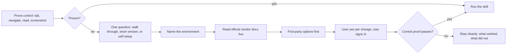

# Browser setup guidance

Every browser-driven skill proves control before it plans, and helps the user
set control up when it is missing. This page is the capability page for that
setup guidance — named for the capability, like `browser-cadence.md` — and the
authoring home for the decision behind it. The operative rules live in the
`twitter-shared.md` section "Browser control setup", copied verbatim into every
X-group member; a future browser-driven group copies the same section under its
own group rules.

## The decision

The skills guide setup by **principles, not vendor specifics**. Documentation
moves, commands change, products are renamed, and a hard-coded matrix would
make every member stale the day a vendor shuffles its docs. So a skill body
never names a vendor command, flag, URL, or menu path. Instead the run:

1. Names the environment it is running in — the app or agent that hosts it —
   or asks which app that is.
2. Reads that vendor's own documentation **live, this run**, and guides from
   what it actually says. A remembered link or command is labelled unverified.
3. Offers first-party options first: the app's built-in browser control, then
   the browser vendor's own MCP server, each translated inline for a new user.
4. Requires the outcome, not a recipe: a real, visible, local browser in which
   the user signs in themselves.
5. Gets the user's yes before every change to their machine, and hands off
   login and challenges.
6. Closes on proof: the run continues only when the same control proof passes.

## Why no examples in the skills

A concrete example — a product name, a URL, a command — is a snapshot. It is
accurate the day it is written and quietly wrong the day the vendor moves it.
Several vendor URLs moved while this page was being verified. The skills
therefore carry the method; the run re-derives the specifics from the live
vendor pages every time, so a vendor change costs nothing and no skill ever
points at a dead link it cannot check.

## Examples (snapshot — verify before relying on them)

Recorded November 2026 while authoring this page, as starting points for a
maintainer, not as runtime truth. Re-verify against the vendor's own pages
before quoting any of them anywhere; expect these to expire.

| Capability | Vendor | Where it was documented |
| --- | --- | --- |
| Browser control via MCP (multi-browser automation) | Microsoft (Playwright MCP) | github.com/microsoft/playwright-mcp |
| Chrome control via MCP | Chrome DevTools team (Chrome DevTools MCP) | github.com/ChromeDevTools/chrome-devtools-mcp |
| MCP servers in Claude Code; Claude in Chrome extension | Anthropic | code.claude.com/docs/en/mcp, code.claude.com/docs/en/chrome |
| MCP servers in Codex CLI | OpenAI | developers.openai.com/codex/mcp |
| MCP servers in Gemini CLI | Google | github.com/google-gemini/gemini-cli (docs/tools/mcp-server.md) |
| MCP servers in OpenCode | OpenCode | opencode.ai/docs/config |
| MCP servers in Cursor | Cursor | cursor.com/docs/mcp |
| MCP servers in VS Code with Copilot | Microsoft | code.visualstudio.com/docs/copilot/chat/mcp-servers |
| MCP servers and bundled browser automation in ZCode | Z.ai | zcode.z.ai/en/docs/welcome, zcode.z.ai/en/docs/mcp-services |

The human-facing walkthrough for new users is
[`docs/users/browser-setup.md`](../users/browser-setup.md), which carries the
same snapshot table with the same caveat.

## Keeping the practice

- The operative section is authored once in `twitter-shared.md` and copied
  verbatim into every member; a group change reaches the central file, every
  copy, the docs pages, and the lode in one change.
- Vendor specifics belong only here and on the user page, both marked as
  snapshots. Never copy one into a skill body, a shared file, or a reference.
- A run may cite a vendor page it read that run; the skill text itself never
  needs one.

## Related

- [Skills catalog](README.md)
- [Human cadence](browser-cadence.md) — the other cross-group browser capability
- [X/Twitter shared core](twitter-core.md)
- [Agent instructions](../developers/agent-instructions.md)
