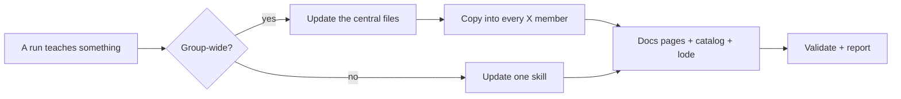

# Shared core for X/Twitter skills

Every browser-driven X skill in this catalog is built from one contract: the
principles, practices, and considerations below. A skill adds only what its own
task needs. When a run teaches something new, the lesson lands here first and
reaches every X skill in the same change.

This page is the single home for the contract: the principles, rationale, and
decisions behind the group's rules. It is a maintainer's page, not a runtime
dependency: a skill folder is installed on its own, so no `SKILL.md` links here.
Each skill carries a copy of every rule it needs, and the group stays consistent
because changes are applied to all copies together.

## Shared files

| File | Role | Copied into members |
| --- | --- | --- |
| `twitter-core.md` | This contract: principles, rationale, and how to change the group | No; it is the authoring page |
| `twitter-shared.md` | Copy-ready operative rules: state line, linked evidence, cadence, access failures, privacy | Yes, verbatim to `references/twitter-shared.md` in every member |

The names carry the group, so a file from another group is never mistaken for
this one. `browser-cadence.md` is a cross-group capability page, named for the
capability rather than a group.

The group index is [`skill-groups.md`](skill-groups.md). Add a group there before
creating its central files.

## The group

| Skill | Task | State |
| --- | --- | --- |
| [`twitter-followback`](../../.agents/skills/twitter-followback/SKILL.md) | Follow back real, active followers | `~/.x-followback/` |
| [`twitter-moot-radar`](../../.agents/skills/twitter-moot-radar/SKILL.md) | Suggest accounts your mutuals follow, matched to your interests | `~/.x-moot-radar/` |
| [`twitter-compatibility`](../../.agents/skills/twitter-compatibility/SKILL.md) | Score interaction compatibility with associated accounts, on chosen subjects and scope, with text-first or opt-in visual evidence | `~/.x-compatibility/` |

The links above point at this repository's copy for browsing. A skill is its
folder, so installing one means copying that folder into a host's skills
directory; its own `SKILL.md` carries every rule it needs.

## Principles

These are not style preferences. Each one exists because getting it wrong
damages the user's account or produces a false claim.

1. **Prove browser control first.** Confirm the relay, open a tab you keep, read
   something from a page, and screenshot it before planning. If control is
   missing, hand back the prerequisites instead of improvising.
2. **The live UI is the source of truth.** X changes labels, layouts, and menus
   without notice. Observe the current vocabulary every run. A memory of last
   run's UI is not evidence.
3. **Confirm the brief, then restate it.** Scope, criteria, exclusions, edge
   cases, and a run budget are agreed up front and read back. "Use your
   judgement" still needs the rubric stated so it can be corrected.
4. **Never handle credentials.** Hand off for login, 2FA, passkey, captcha, or
   payment. Never type a password or a code into a page.
5. **One tested identity per action.** Every click must be tied to the exact
   `@handle` it was researched for, matched by full accessible name. Prefix or
   loose matches can act on a different account. Re-read `location.pathname` and
   the profile header before acting.
6. **Verify, then claim.** Report only what was read on screen during this run. A
   saved state file is memory, not proof. A followed account reads either
   `Following` or `Unfollow` — one state, two labels. Accept both, matched by the
   exact `@handle`; treating only `Following` as proof reports real follows as
   unverified, and clicking what reads `Unfollow` unfollows.
7. **Respect the settle window.** X updates late — well past 30 seconds. Poll the
   same control at jittered checkpoints of roughly 2–4, 7–9, 14–16, and 28–30
   seconds, then re-read at about 60 and 120 seconds before calling a miss; a flip
   near two minutes is on time, not a failure. Re-read before ever retrying.
   Never click the same control twice inside the window — the second click
   reverses a follow or cancels a request.
8. **A throttle is a stop signal, not a retry signal.** Expect a burst of about
   three actions, then a cooldown of minutes. Pause, re-read before retrying
   once, then end the run cleanly and record the resume point. Never work around
   a limit with another account, session, or client.
9. **The user's account, the user's scope.** Never unfollow, block, report, or
   message unless the user asks for that task explicitly. Suggestions modules,
   "who to follow" strips, and Explore are never a work queue.
10. **Bias to skipping.** A missed candidate costs nothing; a bad follow costs
    trust. Thin evidence means no action, and the reason is recorded.
11. **Progress outlives the run.** Lists are virtualised and can hold thousands
    of rows; work ends mid-list. Persist a cursor, a queue, verdicts, and
    follow-ups outside the repository. When state and UI disagree, the UI wins.
    If the file cannot be written, the run continues on session state and prints
    it for the user to verify at every stop; the next run starts fresh and may
    repeat work, which is an accepted cost, never a reason to stop.
12. **Separate what you know from what you inferred.** Reports distinguish
    verified, pending, unverified, skipped, and unreadable. Protected accounts
    are unreadable: no post-based judgement is possible, and the report says so.
    A "potentially sensitive content" interstitial is unreadable the same way —
    the DOM is a notice, not the profile — so nothing about bio, posts, activity,
    or relationship is inferred from it.
13. **Evidence, not adjectives.** "Posts about Rust; bio says systems
    engineer" beats "looks interesting". Name the quote, the date, and where it
    was seen. Never assert an interest, a job, or a relationship that was not
    read.
14. **Privacy stays local.** State holds handles, verdicts, dates, and short
    quotes. No credentials, no full timelines, no bulk personal data, nothing
    inside the repository. Skill text, saved examples, and commits use fictional
    placeholders (`@alice`); a real handle or private detail appears only in that
    account's state file, outside the repository, or in the session output the
    user verifies when writing is unavailable.
15. **Say where progress lives at the start.** As soon as the signed-in account is
    known and before any scanning, give one short state line: the state file path
    and what it currently holds — the criteria or interests in force, queue and
    verdict counts, due follow-ups, and the resume point. If no file exists, name
    the path and say the run starts fresh. Summarize; never dump the file.
16. **Link what you name.** Whenever the run lists a handle — in the state line, a
    question, or the report — link it to its profile, and link every cited post
    or profile fact to the page it came from. Use full `https://x.com/<handle>`
    and status permalinks, with the handle or quote as the link text. Link only
    pages read this run; never invent a URL. State files keep handles, not report
    links.
17. **An unreachable target is not a result.** Distinguish a browser, network, or
    site-access failure from an account or list state. If the page, tab, or
    required control did not render — or a working tab stops responding mid-run —
    stop, say what failed and when, and preserve the resume point. Never infer
    "not followed", "no posts", "empty list", or "skipped" from a page that did
    not load. A click already made when access fails is `unverified` with a
    follow-up, because it may have landed. A login wall, captcha, or checkpoint
    is a handoff; a rate-limit notice keeps the throttle rule.

## Human cadence

Every skill works at a person's pace, drawing each interval and step from a range
rather than a round constant. Identical click rhythms are what rate limiters and
readers notice first. Jitter timing only: one click per control, the full settle
window, and the challenge handoff stay exact.

| Action | Draw each wait from |
| --- | --- |
| First read of a page | 1.5–4 s |
| Before clicking a control | 0.8–2.5 s, after moving the pointer there |
| Between candidates | 4–12 s, with a 20–90 s reading pause every 4–6 |
| Scroll tick | 0.6–2 s; step 1–3 viewport heights, varying each time |
| Stop to read rows | 2–6 s, sometimes scrolling back up a little |
| Typing a handle | 80–250 ms per character |

Move to a control in two to four separate moves, pause, then press, and let the
pointer rest afterwards. Open a run with 30–60 s of reading, and break for 2–5
minutes after roughly 40–60 interactions.

Apply it proportionally: wait for the page or control to exist before the minimum
dwell; take the upper half of the click range and a hover before a state-changing
click; dwell where a person would read, not on every tick; and count cadence
against the run budget. A captcha, checkpoint, or "verify it's you" prompt still
ends the run: pacing is not evasion.

The ranges are canonical in [browser cadence](browser-cadence.md); this page adds
the X-specific settle-window and throttle rules.

## Practices

These are how the skills are shaped, so a reader can move between them without
relearning the flow.

- **Section order**: prerequisites and browser control → learn the current UI →
  confirm the brief → load state → the task loop → verification and limits →
  persistence → honest report → safety rules → done checklist.
- **Observe before acting.** Read several rows and at least two known states
  before deciding what a control means. If the UI does not match the skill, stop
  and resolve it, then say what was confirmed and when.
- **Collect continuously, dedupe by handle.** Virtualised rows unload as they
  leave the viewport; large steps with a pause re-render further down. Two
  empty scroll stops mean the end.
- **Keep payloads compact.** Send handles and short slices, not whole pages;
  large payloads get truncated in transit.
- **Cost is uneven; filter before you research.** List rows are cheap reads;
  profile visits and clicks are the throttled unit. Narrow at the row level and
  shortlist generously before opening profiles.
- **State shape**, one file per signed-in account:

  ```text
  ~/.x-<skill>/<handle>.json
  %USERPROFILE%\.x-<skill>\<handle>.json   (Windows)
  ```

  with `account`, the criteria or interests in force, a resume cursor, a queue of
  collected-but-undecided handles, a verdict per handle, and dated follow-ups.
  Write after each batch, at every stop, and before the run ends. When writing is
  unavailable, keep the same shape in session, print it for the user to verify,
  and continue; resuming is then unavailable and the cost is repeated work.
- **Criteria changes invalidate verdicts.** When the brief changes materially,
  re-derive or archive the affected verdicts rather than applying them to a new
  rubric. Data the brief does not touch — a social graph, a roster — may be kept
  and re-ranked.
- **Same evidence standard everywhere**: profile bio, join date, follower ratio,
  newest posts, and the relationship that surfaced the account.
- **Self-contained bodies, not links.** A `SKILL.md` may reference only files in
  its own folder (`references/`, `scripts/`, `assets/`). It never links to
  `docs/`, `lode/`, `AGENTS.md`, another skill, or any repository path, because a
  copied skill has none of them. Rules are duplicated on purpose; correctness
  beats a single reference.

## Considerations

- Several accounts may be reachable in one browser. Confirm which one is signed
  in before reading anything as "the user's".
- Hidden or background tabs pause rendering and lazy-loading, which looks like a
  broken page. Keep the working tab visible.
- Protected accounts hide posts until they approve a follow request. Their
  posts cannot support any recommendation, and a follow on them reaches
  `Pending`, never `Following`.
- **A relationship is not evidence.** Who follows an account explains why it
  surfaced, not what it posts about. Only the account's own bio and posts can
  support a claim about its interests.
- **A row label is a snapshot, not a relationship.** A Followers row can read
  `Follow` because the account stopped following the user after the list was
  built. That is a stranger: never queued, never researched as a follow-back.
- Blocks, age-restricted accounts, and accounts that changed handles produce
  controls that do not match the expected vocabulary. Record the reason instead
  of retrying.
- Rate limits are often silent: the control simply does not change. Treat
  repeated misses as a stop, not as evidence about the account.
- Users change their mind mid-run. Re-confirm rather than continuing under the
  old rubric.
- Human-scale use only. These skills research and act one account at a time;
  they are not for mass automation, growth hacking, or scraping at volume.

## Changing the core

1. **Classify the lesson.** Would another X skill have to solve it the same way?
   If yes, it belongs in the group. If it is specific to one task, it belongs in
   that skill — and in its `references/` if it needs detail.
2. **Choose the central file.** Principles and rationale go in this page.
   Operative rules go in `twitter-shared.md` as a self-contained instruction.
3. **Propagate in the same change**: copy `twitter-shared.md` verbatim into every
   member's `references/twitter-shared.md`, update this page and each docs page,
   the catalog rows, the group index, and the lode entry for the group.
4. **Validate**: `skills-ref validate` for every touched skill, every copy
   byte-identical to the central file, and the agent-side checks in
   [the skill contract](../../lode/skills/summary.md#checks-before-handing-off).
5. **Never leave a split**: the central file ahead of a copy, or a copy ahead of
   the central file, is a defect, not a work in progress.



## Related

- [Skills catalog](README.md)
- [twitter-followback](../users/twitter-followback.md)
- [twitter-moot-radar](../users/twitter-moot-radar.md)
- [twitter-compatibility](../users/twitter-compatibility.md)
- [Agent instructions](../developers/agent-instructions.md)
