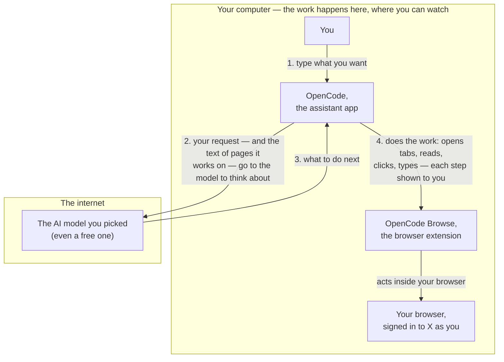
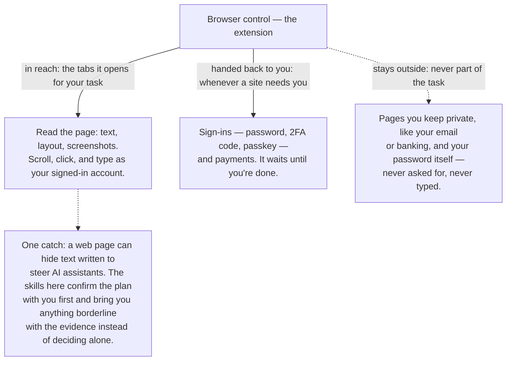

# From zero to your first skill

This page is for the very beginning: no AI assistant installed, nothing set
up, maybe no experience with any of this. It walks you through one fast, free
path from a fresh machine to a working skill on your own X account. About
fifteen minutes, no card required, nothing assumed.

The fast path has three parts:

- **OpenCode** — a free, open-source AI assistant that runs on your own
  computer. You type what you want in a chat; it does the work on your machine
  and shows you each step.
- **Its browser extension** — so the assistant can use the browser you already
  use, signed in where you're signed in. This is what lets a skill see X as
  you.
- **A free model** — the AI brain that does the thinking. OpenCode includes
  free ones, so there is nothing to sign up for elsewhere.

Then you point the assistant at a skill with one message, and it installs the
skill and runs it.

Before the steps, the whole picture — what happens when you type a request,
and what stays on your machine:



Reading the arrows: two things ever leave your computer — what you type, and
the text of the pages the assistant works on. Both go to the AI model you
picked so it can think about them, and the model sends back what to do next.
Everything else happens on your machine, in front of you, and the cycle
repeats until your request is done.

## Step 1: Install OpenCode

OpenCode comes as a normal desktop app for Windows, macOS, and Linux — one
download, installed like any other app. That's the way to use: no terminal
needed on any system. (Accurate when written, November 2026; OpenCode's own
documentation at [opencode.ai/docs](https://opencode.ai/docs) is the source of
truth if anything has moved.)

1. Go to [opencode.ai/download](https://opencode.ai/download) and click the
   download for your system:
   - **Windows** — the `.exe` installer
   - **macOS** — the `.dmg`. If it asks which kind of Mac: Apple Silicon for
     any Mac from late 2020 onward, Intel for older ones
   - **Linux** — `.deb` for Ubuntu and Debian, `.rpm` for Fedora and Red Hat,
     or the `.AppImage` for other distributions
2. Open the downloaded file and install it the way you'd install anything: on
   Windows, run the installer; on macOS, drag the app into your Applications
   folder; on Linux, your system's package installer opens.

When it opens, you're looking at a chat window: type at the bottom, watch the
work happen above. That's the whole interface.

**If you'd rather use the terminal** (macOS or Linux only — Windows has no
terminal installer): open the Terminal app — on macOS it's in Applications →
Utilities, on Linux it's in your app menu — paste this line, and press Enter.
It downloads and installs OpenCode for you in one go:

```bash
curl -fsSL https://opencode.ai/v2/install | bash
```

## Step 2: Connect your browser (one-time, recommended)

The skills in this catalog work on the real X website in **your** browser,
using **your** signed-in session — they see what you see, and they never touch
your password. OpenCode can't see a browser out of the box, so give it the
official extension once and you're done for good:

1. In the browser you already use — Chrome, Edge, Brave, and the like —
   install **[OpenCode Browse](https://chromewebstore.google.com/detail/opencode-browse/mfnicocicmmlkpjnaffgihfjhdgjkdjg)**
   from the Chrome Web Store. The extension walks you through the rest of the
   setup itself; if it asks to run a short setup command, that's normal, and
   your assistant can run it for you.
2. That's it. From now on the assistant works inside your real browser: your
   tabs, your sign-ins, X included. No keys, no extra accounts.

**Worth knowing before you connect.** Browser control is real access to your
browser, so here is the honest version of what you're agreeing to:

- **It sees the pages it works on.** To do a task, the assistant reads the
  tabs it opens — text, layout, screenshots. That page content goes to the
  AI model you picked (even a free one) so it can think about it; the
  extension itself has no server of its own, but the model side is a cloud
  service. Point it at the sites you mean it to use — X, for these skills —
  and not at pages you'd rather keep private, like your email or banking.
- **It acts as you.** It clicks and types inside your signed-in session, so
  whatever it does on X is done by your account. Stay nearby while it
  works; you can take a tab back or stop it at any time.
- **Sign-ins and payments stay yours, always.** Whenever a site needs *you*
  — a password, a 2FA code, a passkey, a payment — the extension hands the
  tab back and waits until you're done. Neither OpenCode nor any skill here
  will ever ask for your X password.
- **Web pages can try to trick an assistant.** A page can hide text written
  to steer AI tools. That's why the skills here only do what you asked,
  confirm the plan with you first, and bring you anything borderline with
  the evidence instead of deciding alone.

The same boundaries as a picture — the task you give it is the fence:



Browser control reaches the tabs you point it at, hands sign-ins and
payments back to you, and never asks for your password.

**Not comfortable with this? You don't have to decide now.** You can skip
the extension entirely and ask your assistant for help instead: type
"help me set up browser control" and it will walk you through the
alternatives — your app's own browser features, or the browser maker's
official tools — step by step if you want. A skill that can't reach a
browser will also stop and offer that same help rather than half-work. The
options it offers are described in
[Setting up browser control](browser-setup.md).

## Step 3: Pick a free model

A model is the AI brain your assistant thinks with, and OpenCode works with
many of them — including free ones built in, so you don't need an account
anywhere else to try this.

In OpenCode, type `/models` to see the list and pick one of the free ones.
Free models have a daily limit — plenty for trying a skill. If OpenCode asks
you to sign in to its free plan first, that's a one-time step. You can switch
models any time, and add a paid provider later only if you ever outgrow the
free ones.

## Step 4: Point it at a skill, and go

A skill is just a folder of instructions your assistant loads when a request
matches it. You don't download anything yourself — you point your assistant at
the skill and ask, and it does the installing.

Copy this into OpenCode and press Enter (accurate when written, November 2026;
if the repository has moved since, the current address is on its
[front page](https://github.com/johndkane/agent-skills)):

```text
Install the twitter-followback skill from
https://github.com/johndkane/agent-skills/tree/main/.agents/skills/twitter-followback
and then review my new followers.
```

Here's what happens:

1. The assistant reads the skill's instructions and copies its folder into the
   place OpenCode keeps skills. That's the whole installation — no settings to
   change.
2. It confirms the skill's rules with you before anything happens: what it
   checks, what it skips, what it will ask.
3. It opens X in your browser and works through your new followers: real,
   active people get followed back; bots, marketing, and impersonators are
   skipped. Every follow is checked in the app before it's called done, and
   borderline accounts are brought to you with the evidence instead of being
   guessed at.

The skill stays installed. Next time you can just say "review my new
followers" — or call it by name. In OpenCode a skill is called with `@`, not
`/`:

```text
@twitter-followback review my new followers
```

Any other skill in this catalog works the same way — point at its folder and
ask. The [user guide](README.md) has one line on each to help you pick.

## If something doesn't work

- **"Can't find the skill", or it never appears** — OpenCode reads its skills
  at startup; quit and reopen it, then try again.
- **Pages won't load, or it says it has no browser** — the extension from
  Step 2 isn't connected, or the browser window is hidden. Keep the window
  visible; reinstall the extension if needed, or follow
  [Setting up browser control](browser-setup.md).
- **The free model hit its limit** — that's the daily cap. Pick a different
  free model from `/models`, or come back tomorrow.
- **Anything else** — the guides below go deeper: [getting
  skills](getting-skills.md) covers every way to install, and [invoking
  skills](invoking.md) covers how to call them in every app.

## Related

- [User guide](README.md) — which skill to choose and what it needs
- [Getting skills](getting-skills.md) — all the ways to install
- [Invoking skills](invoking.md) — how to call a skill in each app
- [Setting up browser control](browser-setup.md) — when you'd rather not use
  the extension
