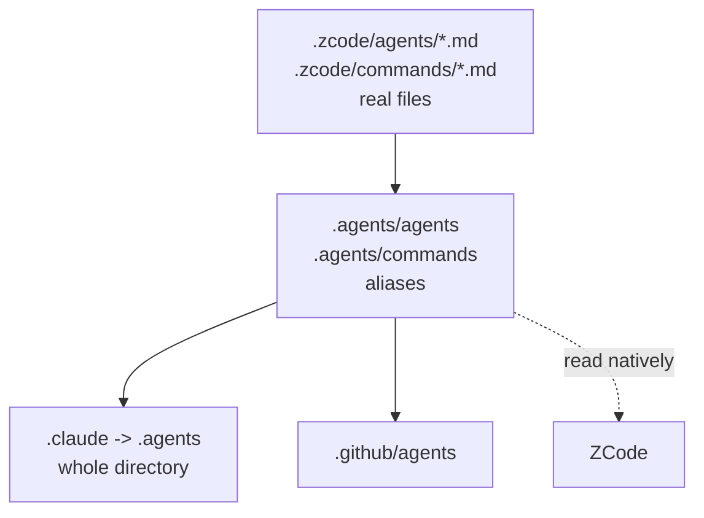

# Agents

Subagent definitions and their slash commands are the catalog's second artifact
type, alongside skills. The real files live in `.zcode/` — ZCode's native
directories — and a committed relative-symlink chain fans them out to the other
apps that read agents:

## Alias chain

| Link | Target | Reader |
| --- | --- | --- |
| `.agents/agents` | `../.zcode/agents` | the cross-agent standard path |
| `.agents/commands` | `../.zcode/commands` | the cross-agent standard path |
| `.claude` | `.agents` (whole directory) | Claude Code — skills, agents, commands |
| `.github/agents` | `.agents/agents` | GitHub Copilot custom agents |

- Every link is relative and recorded as mode `120000`. `.agents/agents`,
  `.agents/commands`, and `.github/agents` are committed directly; the
  `.claude` whole-directory link is created and repaired by
  `scripts/link-skills.*` alongside the skill links.
- OpenCode, Codex, Cursor, and Gemini CLI have no agent directory wired; a
  runtime without subagents reads the agent definition and follows its
  procedure directly — the command file states that fallback.
- Never copy an agent or command file into a host directory; add a link, or the
  copies drift like any duplicate.

## Agent contract

- One file per agent: `name` (kebab-case, matches the file stem),
  `description` stating what, when, and what it is not for, plus `tools` for
  the host's tool allowlist. No host-specific field is load-bearing.
- The `agent-verify` skill is this contract's gate: frontmatter against the
  host dialects (distilled in its `references/host-dialects.md`), safety, body
  shape, catalog wiring, and the alias chain. No official validator exists for
  agent files; its spec checks are manual and dated.
- An agent names the repositories it serves: catalog agents are stock for a
  project shape (root `AGENTS.md`, `lode/`, the named mechanisms), not
  universal reviewers. A new agent documents its expected project shape on its
  user page.
- Read-only reviewer agents never edit, stage, commit, push, or delegate
  onward; scope boundaries between reviewers are stated in each body.

## Catalog

| Agent | Command | Scope |
| --- | --- | --- |
| `dotnet-practices-reviewer` | `/dotnet-practices-review` | .NET asynchrony and advanced-mechanism review of a changeset; stock for its home project's conventions (single `TimeProvider`, cancellation convention, database-enforced concurrency, hosted-service pattern, factory HTTP, streaming seam, telemetry owner, plugin load contract) |

Imported from the `joinup.now3` repository's `.zcode/` tree; that copy can
drift from this one. Human page:
[`docs/users/dotnet-practices-reviewer.md`](../../docs/users/dotnet-practices-reviewer.md);
wiring details: [layout](../layout/summary.md),
[architecture](../../docs/operators/architecture.md).

Related: [skills](../skills/summary.md), [layout](../layout/summary.md).
