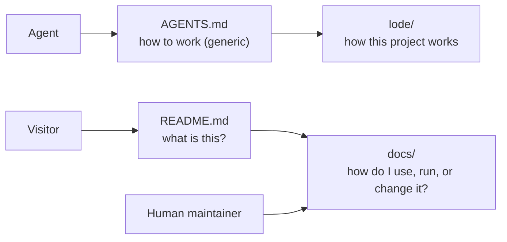

# Documentation

Four surfaces, one job each. `AGENTS.md` is generic agent guidance, `README.md`
is the visitor's entry point, `docs/` is the human wiki, and `lode/` is
project-specific guidance and memory.



## Surfaces

| Surface | Owner | Holds |
| --- | --- | --- |
| `AGENTS.md` | Agents | Repo-agnostic working rules: verification, git, secrets, documentation surfaces. |
| `README.md` | Visitors | High-level overview, project catalog, quick start, links into `docs/`. |
| `docs/` | Humans | All generated documentation: users, operators, developers, and the project reference. |
| `lode/` | Agents | Project-specific rules and persistent memory: layout, invariants, commands, validation. |

## Generic agent file, specific lode

`AGENTS.md` applies to any repository and carries no project details. The lode
carries everything that only makes sense here.

```text
AGENTS.md  -> how to work
lode/      -> how this project works
```

- A new generic rule goes in `AGENTS.md`.
- `AGENTS.md` loads every session, so keep its prose terse. The embedded Lode
  prompt is verbatim, fenced as a `text` block, and sets the floor; compress
  wording, never a rule.
- A new project rule goes in the lode entry that owns the topic, registered in
  `lode/lode-map.md`.
- The human-facing method page is
  [`docs/developers/lode-coding.md`](../../docs/developers/lode-coding.md).

## Audience tree

```text
docs/
├── README.md        index grouped by audience
├── users/           quickstart, user guide, getting skills, invoking, skill guides
├── operators/       architecture, scripts, adopting
├── developers/      agent instructions, lode coding, host differences
└── skills/          catalog, groups, X core/shared, cadence, skill-verify
```

`docs/users/` needs no repository knowledge: it covers getting started from
scratch (the quickstart), choosing a skill, getting it, invoking it, and using
it. `docs/skills/` is the authoring reference. The other two directories own
operating and changing the repository.

## Rules

- `README.md` stays high level. Detail lives on the owning `docs/` page; README
  links to it.
- README's quick start is the visitor's example surface: one concrete install
  line and one plain-language try-it phrase per end-user skill, each linking to
  the owning docs page. It never copies a docs page's example set or the
  per-host syntax matrix.
- The from-scratch walkthrough has one home:
  [`docs/users/quickstart.md`](../../docs/users/quickstart.md) — the OpenCode
  fast path (install OpenCode via the desktop app first on every platform —
  Windows `.exe`, macOS `.dmg`, Linux `.deb`/`.rpm`/`.AppImage`; the terminal
  installer is a macOS/Linux-only alternative since Windows has none; then the
  optional OpenCode Browse extension for the existing signed-in X session, free
  model via `/models`, one install-and-use prompt at a skill URL).
  Step 2 states the browser-control trade-off before the reader connects:
  the assistant sees the pages it works on and that content goes to the
  chosen model (extension has no server of its own; model side is cloud),
  it acts inside the signed-in session, passwords/2FA/passkeys/payments hand
  back to the human, and pages can try to steer the agent (skills confirm
  plans and show evidence instead of deciding alone). It also offers the
  proactive path — ask the agent "help me set up browser control" — which
  `browser-setup.md` owns (that page invites the same ask up front, not only
  after a skill fails).
  `docs/README.md` surfaces it first ("Start here"); the user guide,
  getting-skills, and the top-level README's Get started link to it rather
  than restate it. Its vendor commands and links carry the same "accurate when
  written" dating rule as `browser-setup.md`; the current terminal installer is
  `https://opencode.ai/v2/install` (verified 2026-11-21).
- One behavior has one home in `docs/`. Other pages link rather than restate.
- `docs/` and `lode/` never swap roles. Lode rationale does not move into `docs/`,
  and `docs/` is not an agent scratchpad.
- Human pages link only to human pages. A user or operator page never links into
  `lode/` or `AGENTS.md`; a developer page may, to explain an agentic mechanism or
  practice.
- User-facing voice: `README.md` and `docs/users/` are written in plain, friendly
  language for a reader who doesn't know this repo — everyday words over mechanism
  names ("a progress file on your machine", not "state file"; terms explained where
  they first appear), with tables and command blocks kept verbatim as reference and
  every rule, number, and safety boundary unchanged. The terse, precise register
  stays in skill bodies and `docs/skills/`; friendliness lives only on human pages.
- A change updates the human page and this lode in the same session.

```text
README.md  ->  docs/  ->  the audience page that owns the detail
             \-> lode/  ->  why, for the next session
```

Related: [practices](../practices.md), [layout](../layout/summary.md),
[terminology](../terminology.md).
