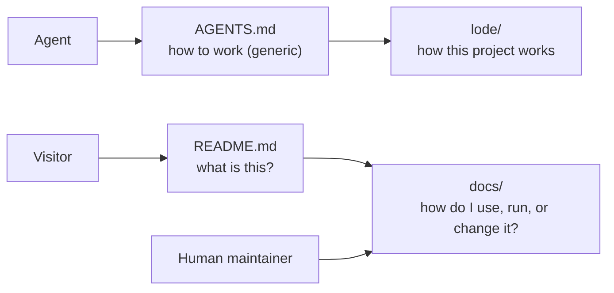

# Documentation

Four surfaces, one job each. `AGENTS.md` is generic agent guidance, `README.md`
is the visitor's entry point, `docs/` is the human wiki, and `lode/` is
project-specific guidance and memory.



## Surfaces

| Surface | Owner | Holds |
| --- | --- | --- |
| `AGENTS.md` | Agents | Repo-agnostic working rules: verification, git, secrets, documentation surfaces. |
| `README.md` | Visitors | High-level overview, project catalog, quick start, links into `docs/`. |
| `docs/` | Humans | All generated documentation: users, operators, developers, and the project reference. |
| `lode/` | Agents | Project-specific rules and persistent memory: layout, invariants, commands, validation. |

## Generic agent file, specific lode

`AGENTS.md` applies to any repository and carries no project details. The lode
carries everything that only makes sense here.

```text
AGENTS.md  -> how to work
lode/      -> how this project works
```

- A new generic rule goes in `AGENTS.md`.
- A new project rule goes in the lode entry that owns the topic, registered in
  `lode/lode-map.md`.
- The human-facing method page is
  [`docs/developers/lode-coding.md`](../../docs/developers/lode-coding.md).

## Audience tree

```text
docs/
├── README.md        index grouped by audience
├── users/           user guide, getting skills, invoking, skill guides
├── operators/       architecture, scripts, adopting
├── developers/      agent instructions, lode coding, host differences
└── skills/          catalog, groups, X core/shared, cadence, skill-verify
```

`docs/users/` needs no repository knowledge: it covers choosing a skill, getting
it, invoking it, and using it. `docs/skills/` is the authoring reference. The
other two directories own operating and changing the repository.

## Rules

- `README.md` stays high level. Detail lives on the owning `docs/` page; README
  links to it.
- One behavior has one home in `docs/`. Other pages link rather than restate.
- `docs/` and `lode/` never swap roles. Lode rationale does not move into `docs/`,
  and `docs/` is not an agent scratchpad.
- Human pages link only to human pages. A user or operator page never links into
  `lode/` or `AGENTS.md`; a developer page may, to explain an agentic mechanism or
  practice.
- A change updates the human page and this lode in the same session.

```text
README.md  ->  docs/  ->  the audience page that owns the detail
             \-> lode/  ->  why, for the next session
```

Related: [practices](../practices.md), [layout](../layout/summary.md),
[terminology](../terminology.md).
