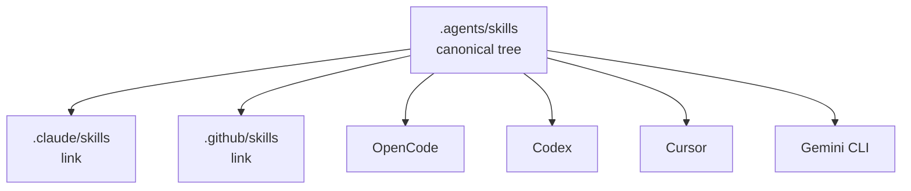

# Layout

The repository has one real skill tree and thin links for hosts that need them.



## Invariants

- `.agents/skills/<name>/SKILL.md` is the only copy.
- Every link is relative and points at `../.agents/skills`.
- Git stores links as mode `120000`; a plain text file means the checkout lacked
  symlink support.
- Host directories that read the canonical tree are opt-in.

## Why this shape

A copy per host drifts and cannot be validated once. A link keeps one source of
truth and needs no maintenance when a skill is added, because each link points at
the directory rather than at a skill.

## Recovery

A checkout without symlinks leaves a plain file containing `../.agents/skills`.
Both scripts detect that placeholder and replace it.

```bash
./scripts/link-skills.sh
```

```powershell
./scripts/link-skills.ps1
```

Related: [practices](../practices.md), [scripts](../scripts/summary.md).
