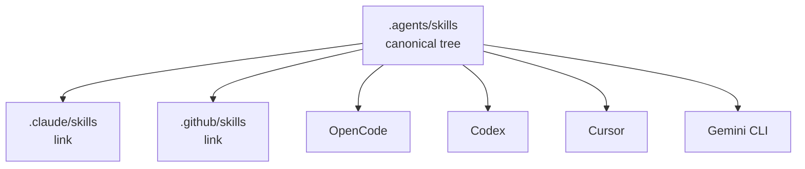

# Layout

The repository has one real skill tree and thin links for hosts that need them.



## Repository tree

```text
agent-skills/
├── .agents/
│   └── skills/                       # canonical source of truth
│       ├── twitter-followback/
│       ├── twitter-moot-radar/
│       ├── twitter-compatibility/
│       ├── twitter-following-audit/
│       └── skill-verify/
├── .claude/
│   └── skills -> ../.agents/skills   # Claude Code
├── .github/
│   └── skills -> ../.agents/skills   # GitHub Copilot
├── scripts/
│   ├── link-skills.sh
│   └── link-skills.ps1
├── docs/                             # human documentation, by audience
├── lode/                             # agent memory (Lode Coding)
├── AGENTS.md                         # generic agent guidance
├── CLAUDE.md                         # imports AGENTS.md
└── README.md                         # high-level overview
```

## Invariants

Breaking these breaks every host at once. Do not change them without an explicit
request.

1. `.agents/skills/<name>/SKILL.md` is the only copy. Never duplicate a skill into
   a host-specific directory.
2. Every agent link is a relative symlink to `../.agents/skills`. Never replace
   one with a real directory and never commit a copy of the tree.
3. Symlink targets stay relative. Git must record every link as mode `120000`.
4. Never add `.agents/` or any agent link to `.gitignore`.
5. Default wiring is `claude` + `copilot`. `.opencode/skills`, `.cursor/skills`,
   and `.gemini/skills` are opt-in, because those hosts already read
   `.agents/skills` and a second path surfaces every skill twice. Never commit an
   opt-in link without a reason.
6. The repository stays droppable into another project: no build step, no
   generated artifacts, no dependencies to install.

## Why this shape

A copy per host drifts and cannot be validated once. A link keeps one source of
truth and needs no maintenance when a skill is added, because each link points at
the directory rather than at a skill.

## Recovery

A checkout without symlinks leaves a plain file containing `../.agents/skills`.
Both scripts detect that placeholder and replace it.

```bash
./scripts/link-skills.sh
```

```powershell
./scripts/link-skills.ps1
```

## Checks

- `git ls-files -s` shows `120000` for `.claude/skills` and `.github/skills`.
- `bash -n scripts/link-skills.sh` passes.
- Both scripts report `ok` on a default run.

## Documentation

`README.md` is the high-level overview, `docs/` is human documentation by audience,
and `lode/` is project-specific guidance and memory. See
[documentation](../documentation/summary.md).

Related: [practices](../practices.md), [scripts](../scripts/summary.md),
[documentation](../documentation/summary.md).
