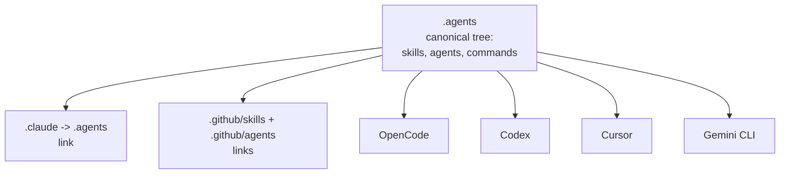

# Layout

The repository has one real skill tree and thin links for hosts that need them.



## Repository tree

```text
agent-skills/
├── .agents/
│   ├── skills/                       # canonical skill tree
│   │   ├── twitter-followback/
│   │   ├── twitter-moot-radar/
│   │   ├── twitter-compatibility/
│   │   ├── twitter-following-audit/
│   │   ├── skill-verify/
│   │   └── software-documentation/
│   ├── agents -> ../.zcode/agents    # agent alias
│   └── commands -> ../.zcode/commands  # command alias
├── .zcode/
│   ├── agents/                       # real agent files
│   │   └── dotnet-practices-reviewer.md
│   ├── commands/                     # real command files
│   │   └── dotnet-practices-review.md
│   └── plans/                        # session-plan scratch, drafts ignored
│       └── .gitignore                # placeholder keeps the folder tracked
├── .claude -> .agents                # Claude Code: skills, agents, commands
├── .github/
│   ├── skills -> ../.agents/skills   # GitHub Copilot
│   ├── agents -> ../.agents/agents   # GitHub Copilot custom agents
│   └── copilot-instructions.md -> ../AGENTS.md
├── agents/                           # cross-app *.agent.md definitions (empty)
│   └── .gitignore
├── prompts/                          # agent-method prompt sources (empty)
│   └── .gitignore
├── scripts/
│   ├── link-skills.sh
│   └── link-skills.ps1
├── docs/                             # human documentation, by audience
├── lode/                             # agent memory (Lode Coding)
├── AGENTS.md                         # generic agent guidance
├── CLAUDE.md                         # imports AGENTS.md
└── README.md                         # high-level overview
```

## Invariants

Breaking these breaks every host at once. Do not change them without an explicit
request.

1. `.agents/skills/<name>/SKILL.md` is the only copy. Never duplicate a skill into
   a host-specific directory.
2. `.claude` is a whole-directory relative symlink to `.agents`; every other
   agent link is a relative symlink into the canonical tree (`../.agents/skills`,
   `../.zcode/agents`, `../AGENTS.md`). Never replace a link with a real
   directory and never commit a copy of the tree.
3. Symlink targets stay relative. Git must record every link as mode `120000`.
4. Never add `.agents/` or any agent link to `.gitignore`.
5. Default wiring is `claude` + `copilot`. `.opencode/skills`, `.cursor/skills`,
   and `.gemini/skills` are opt-in, because those hosts already read
   `.agents/skills` and a second path surfaces every skill twice. Never commit an
   opt-in link without a reason.
6. The repository stays droppable into another project: no build step, no
   generated artifacts, no dependencies to install.
7. Agent and command files have one real copy in `.zcode/agents` and
   `.zcode/commands`. The `.agents/agents`, `.agents/commands`, and
   `.github/agents` links are committed directly; Claude Code reaches them
   through the whole-directory `.claude -> .agents` symlink, which the link
   scripts create and repair. Only `.zcode/plans/` scratch is ignored, around
   its tracked placeholder `.gitignore`.
8. Empty agent-support directories (`agents/`, `prompts/`, `.zcode/plans/`)
   keep an empty tracked `.gitignore` placeholder so the remote retains them.

## Why this shape

A copy per host drifts and cannot be validated once. A link keeps one source of
truth and needs no maintenance when a skill is added, because each link points at
the directory rather than at a skill.

## Recovery

A checkout without symlinks leaves each link as a plain file containing its
target (`../.agents/skills`, or `.agents` for `.claude`). Both scripts detect
that placeholder and replace it.

```bash
./scripts/link-skills.sh
```

```powershell
./scripts/link-skills.ps1
```

## Checks

- `git ls-files -s` shows `120000` for `.claude`, `.github/skills`,
  `.github/copilot-instructions.md`, `.agents/agents`, `.agents/commands`, and
  `.github/agents`.
- `bash -n scripts/link-skills.sh` passes.
- Both scripts report `ok` on a default run.

## Documentation

`README.md` is the high-level overview, `docs/` is human documentation by audience,
and `lode/` is project-specific guidance and memory. See
[documentation](../documentation/summary.md).

Related: [practices](../practices.md), [scripts](../scripts/summary.md),
[documentation](../documentation/summary.md).
