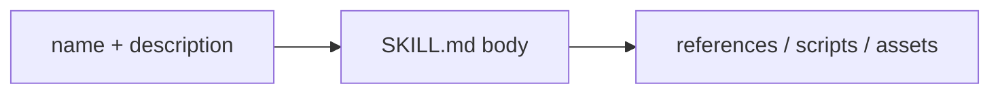

# Practices

## One copy, many links

Never duplicate a skill. A host that cannot read `.agents/skills` gets a link,
not a copy.

```text
.agents/skills/<name>/SKILL.md        source
.claude/skills -> ../.agents/skills   link
```

Reason: copies drift, and validation then proves only one copy is correct.

## Default to the minimum wiring

Only `claude` and `copilot` are wired by default. Other hosts read the canonical
tree already, and a second path can surface each skill twice.

```bash
./scripts/link-skills.sh          # claude + copilot
./scripts/link-skills.sh --all    # explicit opt-in
```

## Validate with the reference implementation

Do not judge a skill by eye.

```bash
.venv/bin/skills-ref validate .agents/skills/<name>
```

## Keep the description honest

The description is the only text a host sees before loading a skill. It states
what the skill does, when to use it, and what it is not for. Trigger words go
first because some hosts shorten long descriptions.

## Git writes are opt-in

Agents query Git freely and write to it only on explicit request. A request to
implement something is not a request to commit.

## Keep the scripts in step

`link-skills.sh` and `link-skills.ps1` share behaviour: the same environment
names, defaults, force flag, and placeholder recovery. A change to one is a
change to both.

## One lesson, whole family

Browser-driven X skills share one contract,
[`docs/skills/twitter-core.md`](../docs/skills/twitter-core.md). A new lesson goes
into the core first, then into every X skill, its docs page, and its lode entry
in the same change.

```text
run -> lesson -> core -> every X skill body + docs page + lode
```

Reason: the family may not disagree on browser control, identity matching,
timing, throttling, credentials, state shape, evidence, or reporting honesty.

A skill folder is installed on its own, so no `SKILL.md` links to the core, the
lode, `docs/`, or another skill. The lesson is copied into each skill body. The
core is where it is decided, not where a runtime reads it.

## Write for agents

Skill bodies are runtime instructions, not documentation. Use terse imperatives,
tables, and checklists; aim for ~200–300 lines and under ~3,000 tokens, with 500
lines / 5,000 tokens as the ceiling. Cut motivation prose, repetition, and
restated examples before cutting a rule. Dense detail lives in one-level-deep
`references/` files that the body names.



## Verify through the skill

Skill creation is not done until `skill-verify` runs and passes. The checklist in
`AGENTS.md` is the fallback when file or shell access is missing, not the primary
gate. A `pass` needs evidence; an unavailable check is `unverified`.

Related: [layout](layout/summary.md), [skills](skills/summary.md),
[scripts](scripts/summary.md).
