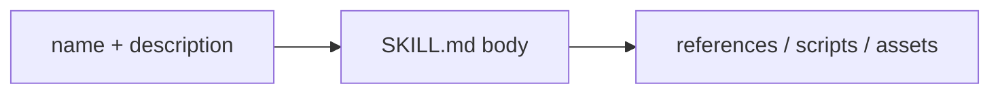

# Practices

## One copy, many links

Never duplicate a skill. A host that cannot read `.agents/skills` gets a link,
not a copy.

```text
.agents/skills/<name>/SKILL.md        source
.claude/skills -> ../.agents/skills   link
```

Reason: copies drift, and validation then proves only one copy is correct.

## Default to the minimum wiring

Only `claude` and `copilot` are wired by default. Other hosts read the canonical
tree already, and a second path can surface each skill twice.

```bash
./scripts/link-skills.sh          # claude + copilot
./scripts/link-skills.sh --all    # explicit opt-in
```

## Validate with the reference implementation

Do not judge a skill by eye.

```bash
.venv/bin/skills-ref validate .agents/skills/<name>
```

## Keep the description honest

The description is the only text a host sees before loading a skill. It states
what the skill does, when to use it, and what it is not for. Trigger words go
first because some hosts shorten long descriptions.

## Four surfaces, no overlap

`AGENTS.md` is generic agent guidance, `README.md` is the visitor's overview,
`docs/` is the human wiki by audience, and `lode/` is project-specific guidance
and memory. A fact lives on one surface; the others link.

```text
AGENTS.md -> how to work
README.md -> docs/<audience>/page.md
docs/     -> the reader's task
lode/     -> how this project works, for the next session
```

Reason: a README that grows into a manual hides the entry point, and mixing docs
with lode either loses the rationale or exposes agent notes to readers. Human
pages link only to human pages; only developer pages may reference the lode or
`AGENTS.md`, and only to explain an agentic mechanism or practice. Full contract:
[documentation](documentation/summary.md).

## Generic AGENTS, specific lode

`AGENTS.md` carries only rules that apply to any repository. Project layout,
invariants, commands, validation, and the skill rules live in the lode.

```text
AGENTS.md -> how to work (generic)
lode/     -> how this project works (specific)
```

Reason: the instruction file can be copied into another repository unchanged,
while the lode describes this one. A new project rule goes into the lode entry
that owns the topic, registered in `lode/lode-map.md`.

## Git writes are opt-in

Agents query Git freely and write to it only on explicit request. A request to
implement something is not a request to commit.

## Keep the scripts in step

`link-skills.sh` and `link-skills.ps1` share behaviour: the same environment
names, defaults, force flag, and placeholder recovery. A change to one is a
change to both.

## One lesson, whole group

Browser-driven X skills form a group with two central files:
[`twitter-core.md`](../docs/skills/twitter-core.md) for the contract and
[`twitter-shared.md`](../docs/skills/twitter-shared.md) for operative rules. A
new lesson is classified, then lands in the contract or the shared file.
Operative changes are copied verbatim into every member's
`references/twitter-shared.md`; docs pages, catalog rows, the group index, and
lode entries follow in the same change.

```text
run -> lesson -> central file -> every member copy + docs page + lode
```

Reason: the group may not disagree on browser control, identity matching, timing,
throttling, credentials, state shape, evidence, or reporting honesty.

A skill folder is installed on its own, so no `SKILL.md` links to a central file,
the lode, `docs/`, or another skill. Operative rules are copied into each member,
not linked. The central file is where they are decided, not where a runtime reads
them.

## Browser skills pace like people

Any skill that drives a browser to navigate, scroll, click, or type copies the
ranges from [`docs/skills/browser-cadence.md`](../docs/skills/browser-cadence.md)
into its body and applies them proportionally.

```text
readiness -> minimum dwell -> read longer -> hover before acting
cadence counts against the budget; verification and challenge handling stay exact
```

Reason: machine-regular clicks are what rate limiters and readers notice. Jitter
is pacing, not evasion, and never widens a settle window, skips a verification, or
passes a challenge. A new browser-action skill is not complete without a cadence
section.

## No real handles or personal data

Skill text, docs, lode entries, and commit messages use fictional placeholders
(`@alice`, `example.com`). A real handle, name, email, or private detail never
enters a file in this repository.

An online skill's folder is instructions, not run memory. Saved quotes,
permalinks, profile excerpts, follower lists, screenshots, and state dumps stay
out, exactly like real handles.

```text
skill text / docs / lode / commits  ->  placeholders only
~/.x-<skill>/<handle>.json          ->  the real handle, verdicts, dates
```

Reason: a skill folder is copied to other machines and Git history is permanent.
The state file is runtime data, kept outside the repository; it persists between
runs so a long task resumes instead of redoing the research. When file write is
refused or unavailable, the run continues on session state of the same shape,
prints it for the user to verify, and accepts that the next run may repeat work;
persistence is never a reason to stop.

## Expect mid-session changes

The human may edit, commit, or restructure the repository while an agent works.
The disk is the source of truth; an earlier read is not.

```text
read -> developer edits -> re-read before acting -> adapt or report -> never revert
```

Treat unfamiliar edits as the developer's work in progress. If a change conflicts
with the task, say what changed and ask only when intent is unclear. Git writes
remain opt-in.

## Write for agents

Skill bodies are runtime instructions, not documentation. Use terse imperatives,
tables, and checklists. The pass line is the official recommendation: 500 lines
and ~5,000 tokens; the ~200–300 line / ~3,000-token aim is advisory. Cut
motivation prose, repetition, and restated examples before cutting a rule. Dense
detail lives in one-level-deep `references/` files that the body names.



## Verify through the skill

Skill creation is not done until `skill-verify` runs and passes. The checklist in
[the skill contract](skills/summary.md#checks-before-handing-off) is the fallback
when file or shell access is missing, not the primary gate. A `pass` needs
evidence; an unavailable check is `unverified`.

Related: [layout](layout/summary.md), [documentation](documentation/summary.md),
[skills](skills/summary.md), [scripts](scripts/summary.md).
