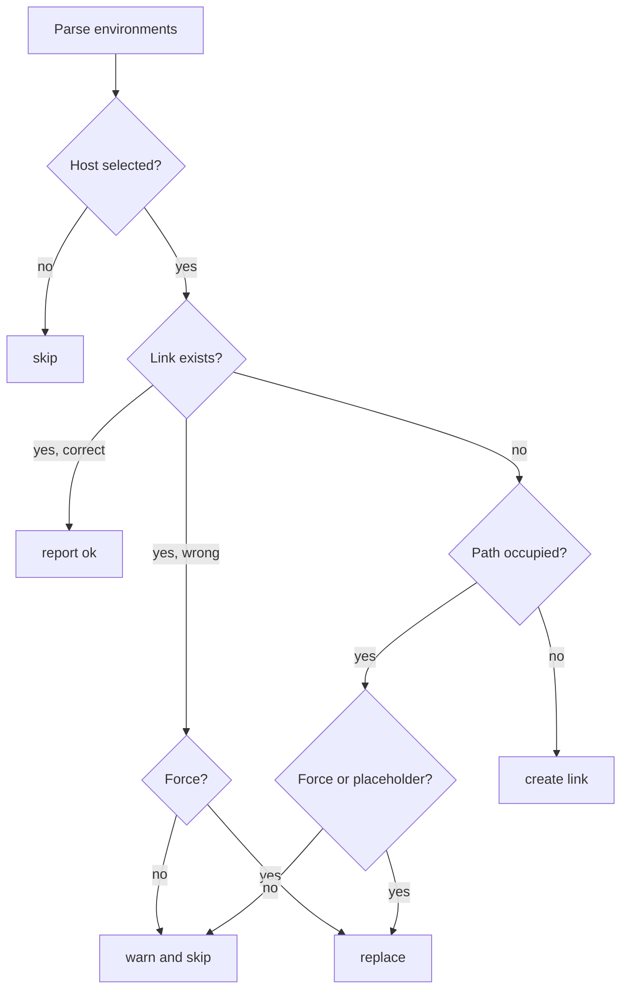

# Scripts

`scripts/link-skills.sh` and `scripts/link-skills.ps1` wire the catalog. They
share behaviour; only the shell differs.

## Decision flow



## Environments

| Name | Path | Default |
| --- | --- | --- |
| `claude` | `.claude -> .agents` (whole directory) | yes |
| `copilot` | `.github/skills` | yes |
| `opencode` | `.opencode/skills` | no |
| `cursor` | `.cursor/skills` | no |
| `gemini` | `.gemini/skills` | no |
| `codex` | none; reads the canonical tree | no |

## Contract

- Each host carries its own link target, resolved from the link's parent: the
  skill hosts link `../.agents/skills`; `claude` links the whole `.agents`
  directory, serving skills, agents, and commands.
- No arguments wires `claude` and `copilot`.
- Named environments wire exactly those.
- `--all`/`-All` wires every host, including the native ones.
- `--force`/`-Force` replaces a real directory or a wrong link.
- Placeholder files from a `core.symlinks=false` checkout are replaced without
  force.
- Unknown environments exit with a usage error.
- On Windows, when symlink creation is refused, the PowerShell script falls
  back to a directory junction and the shell script reports the failure. A
  junction is a local convenience, never the committed shape: git still records
  the link as a relative `120000` symlink.
- Exit status is `0` on success, `1` for an environment problem (missing
  canonical tree, nothing wired), and `2` for a usage error (unknown
  environment or option).

```bash
./scripts/link-skills.sh cursor
./scripts/link-skills.ps1 -All -Force
```

## Commands

```bash
./scripts/link-skills.sh                  # claude + copilot (default)
./scripts/link-skills.sh cursor           # one host
./scripts/link-skills.sh --all --force    # every host, replace anything odd
```

```powershell
./scripts/link-skills.ps1 -All
./scripts/link-skills.ps1 claude cursor -Force
```

Related: [layout](../layout/summary.md), [practices](../practices.md).
