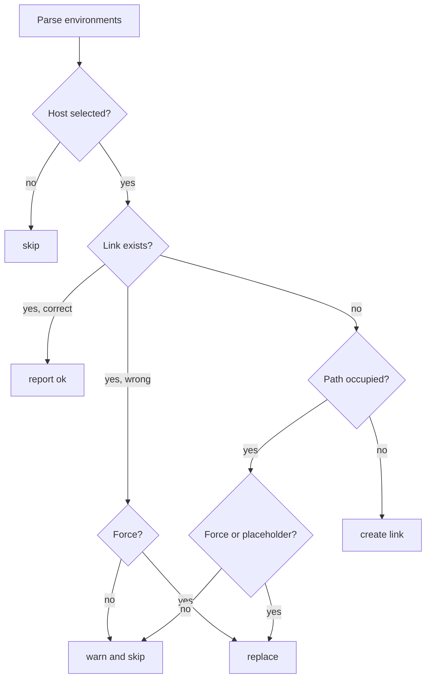

# Scripts

`scripts/link-skills.sh` and `scripts/link-skills.ps1` wire the catalog. They
share behaviour; only the shell differs.

## Decision flow



## Environments

| Name | Path | Default |
| --- | --- | --- |
| `claude` | `.claude/skills` | yes |
| `copilot` | `.github/skills` | yes |
| `opencode` | `.opencode/skills` | no |
| `cursor` | `.cursor/skills` | no |
| `gemini` | `.gemini/skills` | no |
| `codex` | none; reads the canonical tree | no |

## Contract

- No arguments wires `claude` and `copilot`.
- Named environments wire exactly those.
- `--all`/`-All` wires every host, including the native ones.
- `--force`/`-Force` replaces a real directory or a wrong link.
- Placeholder files from a `core.symlinks=false` checkout are replaced without
  force.
- Unknown environments exit with a usage error.

```bash
./scripts/link-skills.sh cursor
./scripts/link-skills.ps1 -All -Force
```

Related: [layout](../layout/summary.md), [practices](../practices.md).
