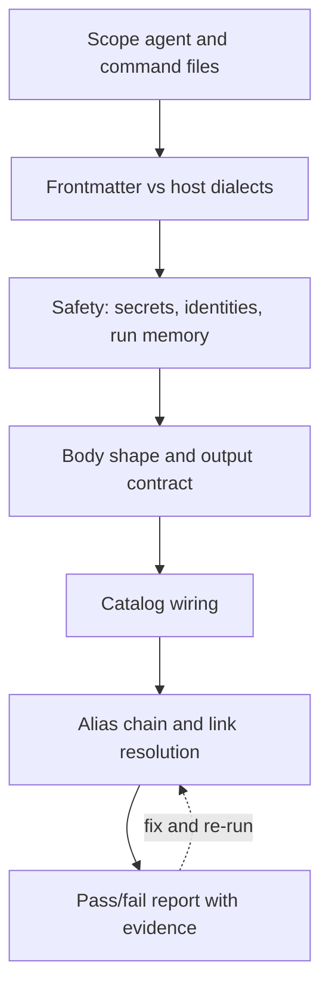

# agent-verify

The agent layer's gate. It checks an agent definition or command file against
the official host specifications and the catalog rules, and reports pass/fail
with evidence. Canonical instructions:
[`SKILL.md`](../../.agents/skills/agent-verify/SKILL.md); human page:
[`docs/skills/agent-verify.md`](../../docs/skills/agent-verify.md); distilled
per-host spec tables live inside the folder at
`references/host-dialects.md`.

## Invariants

1. It runs before any agent or command file is reported as done; a manual read
   of the checklist is a fallback, not a substitute.
2. Read-only unless the user asked for fixes; affected checks are re-run after
   a fix.
3. Every result cites evidence, and an unavailable check is `unverified`,
   never `pass`.
4. No official validator exists for agent files — `skills-ref` is skills-only —
   so every frontmatter check is a manual comparison against the distilled
   specs, and the skill says so rather than implying validator coverage.
5. The repository's identity rule is the strictest useful intersection:
   lowercase ASCII kebab-case `name` equal to the file stem, applied
   everywhere, because Claude Code keys on `name`, OpenCode on the filename,
   and Copilot on filename-minus-extension.
6. Agents are project-scoped stock: unlike skills, an agent body may name
   repository paths it reads. Secrets, real identities, and run memory still
   fail; an absolute local path is a portability finding.
7. Tool names are host vocabularies, not a standard; a dialect-only field is
   flagged as dead weight on other hosts, never failed.
8. The distilled dialect tables carry a consultation date and expire; the
   check re-reads the official page live before relying on any field outside
   `name`, `description`, and `tools`.

## Sources

| Source | Scope | Status |
| --- | --- | --- |
| Claude Code subagents docs | `.claude/agents` format | Official, used |
| GitHub Copilot custom agents reference | `.github/agents` format | Official, used |
| VS Code custom agents docs | IDE-side fields | Official, used |
| OpenCode agents docs | `.opencode/agents` format | Official, used |
| ZCode agent definitions | `.zcode/agents` observed shape | No spec in hand |
| `skills-ref` | Skills frontmatter only | Official, not applicable |

## Checks

## Limits

- Size figures are estimates; the only official body cap is Copilot's
  30,000-character limit, and the ~300-line aim is advisory.
- The ZCode dialect is the observed shape with no published spec in hand; its
  rows are marked unverified in the reference file.
- Whether a host truly resolves a tool name is a vocabulary check against a
  moving target; the gate proves format, not runtime availability.

Related: [skills summary](summary.md), [agents summary](../agents/summary.md),
[skill-verify](skill-verify.md).
