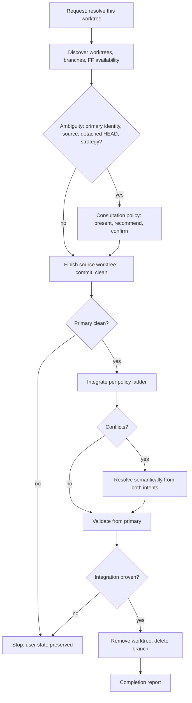

# resolve-worktree-to-primary

The catalog's Git worktree-finishing skill: it integrates a linked worktree's
branch into the branch checked out in the repository's primary worktree, then
verifies and cleans up. Canonical instructions:
[`SKILL.md`](../../.agents/skills/resolve-worktree-to-primary/SKILL.md); human
page:
[`docs/users/resolve-worktree-to-primary.md`](../../docs/users/resolve-worktree-to-primary.md).
Authored outside this repository and imported; the user's installed copy under
`~/.agents/skills` can drift from this one, and this catalog's copy is the one
this repository documents.

## Rules the skill carries

- **Discover, never assume** — every path, worktree, and branch name comes from
  Git (`git worktree list --porcelain`, `git rev-parse`,
  `git branch --show-current`). "Primary branch" is the branch checked out in
  `git worktree list`'s first entry, whatever it is named.
- **Consultation policy** — choices repository evidence makes obvious proceed
  and are reported; unclear source (several linked worktrees), detached HEAD,
  user-named non-primary target, or an equivocal strategy assessment stops
  before any Git mutation for an explicit confirmation. "Force it" removes the
  confirmation pauses only — never the safety rules or gates.
- **Finish the source first** — remaining changes reviewed and committed, the
  tree left clean; unrelated changes are never committed just to get there.
- **Primary untouched** — uncommitted primary-worktree changes stop the run;
  no stashing, committing, or resetting them.
- **Strategy ladder** — policy first (docs, merge history), then source
  history quality, sharing (`git branch -r --contains`, upstream), and FF
  availability; the ladder picks fast-forward, squash, rebase-then-FF, or a
  merge commit, reported with its reason. No extra flags without a rationale.
- **Semantic conflict resolution** — read the index stages (`:1:/:2:/:3:`),
  reconstruct each side's intent from history, integrate both aspects or let
  superseding work define the shape, and account for every intent:
  integrated, re-expressed, or explicitly dropped with a reason. Stop only when
  intents are semantically unanswerable from repository evidence; leave the
  merge state intact. Under this workflow ours is always the target side.
- **Integrate, verify, clean up last** — project validation runs from the
  primary after integration; removal happens only after the integration is
  proven (`merge-base --is-ancestor` for true merges; the completed three-way
  merge plus clean status plus passed validation for a squash, which has no
  ancestry proof).
- **Gated cleanup** — `git worktree remove` without `--force`; a mid-delete
  failure is diagnosed (unregistered + not-a-repository + no user work →
  `prune`, finish, report the inert husk), never forced. `git branch -d`
  normally; the disclosed `-D` only in the proven squash exception. Remote
  branches are never deleted unless explicitly requested; nothing is pushed
  unless explicitly requested.

## Identity

- Not a group member: no browser, no group-shared file, no runtime state; the
  `compatibility` field names Git on PATH and shell access in both worktrees.
- Self-contained: the body names no file outside its folder. Its `AGENTS.md`,
  `CLAUDE.md`, and `CONTRIBUTING.md` strings are the target repository's
  instruction files to read there — the usual self-containment grep hits them,
  and the judgment is link-or-dependency, which these are not (same call as
  [software-documentation](software-documentation.md)'s `docs/` strings).
- No runtime data: it writes nothing outside Git itself; no state file, no
  persistence fallback needed.

## Catalog wiring

README bullet under "The skills"; catalog row in `docs/skills/README.md`; row
in `docs/README.md` users table and `docs/users/README.md` (table and
choose-list); page at
`docs/users/resolve-worktree-to-primary.md`; tree entries in
`docs/operators/architecture.md` and [layout](../layout/summary.md); the
terminology entries "Worktree resolution" and "Primary worktree"; this file
and its `lode-map.md` row.

Related: [skills summary](summary.md), [skill-verify](skill-verify.md),
[group rules](groups.md).
