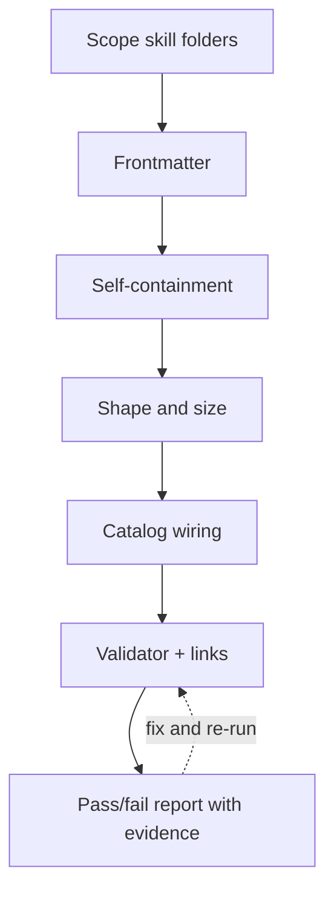

# skill-verify

The repository's skill gate. It checks a skill folder against the catalog rules
and reports pass/fail with evidence. Canonical instructions:
[`SKILL.md`](../../.agents/skills/skill-verify/SKILL.md); human page:
[`docs/skills/skill-verify.md`](../../docs/skills/skill-verify.md).

## Invariants

1. It runs before any skill creation or change is reported as done; a manual
   read of the checklist is a fallback, not a substitute.
2. Read-only unless the user asked for fixes; a fix belongs to the change under
   review, and affected checks are re-run after it.
3. Every result cites evidence — path and line, or command output — and an
   unavailable check is `unverified`, never `pass`.
4. The body is self-contained. It may name repository paths as things it checks,
   but never links to them as resources.
5. A skill passes only when every required check passes; the report lists what
   remains otherwise.
6. No real identities: skill text, docs, and lode use fictional placeholders, and
   a real handle or private detail belongs only to the runtime state file.
7. The frontmatter and naming check is the official `skills-ref` CLI; the gate
   adds repository checks instead of reimplementing the specification.
8. There is no official replacement skill. The Agent Skills project publishes
   only `skills-ref`; Anthropic's official `skill-creator` is authoring-focused
   and uses Claude-only tools, so it cannot serve this cross-agent gate.
9. The third-party `skill-validator` (agent-ecosystem) may supplement structure,
   link, orphan, and token checks when it is already on `PATH`. Its absence is
   never a failure, and it is never installed to make a check pass.
10. Personal data never ships in a skill folder. Online skills in particular keep
    no run artifacts — real handles, saved quotes, permalinks, screenshots,
    follower lists, state dumps, credentials, cookies, or session tokens — in
    `SKILL.md`, `references/`, `scripts/`, or `assets/`. Only placeholders are
    allowed; runtime state stays outside the folder. A placeholder URL such as
    `https://x.com/<handle>` is fine; a specific profile or status URL from a run
    is not.

## Sources

| Source | Scope | Status |
| --- | --- | --- |
| `skills-ref` | Frontmatter, naming, directory match | Official, required |
| Anthropic `skill-creator` | Authoring, evaluation, description tuning | Official, not used |
| `agent-ecosystem/skill-validator` | Structure, links, tokens, orphans | Third-party, optional |

## Checks

## Why a skill, not only a checklist

A checklist in `AGENTS.md` states the rule; the skill executes it: resolves the
repo root, derives scope from git, runs the validator, resolves links, measures
the body, and returns evidence. The checklist stays as the documented fallback
when file or shell access is missing.

## Limits

- Token count is estimated as characters / 4, not tokenizer output; the report
  says so.
- The validator is `.venv/skills-ref` or `skills-ref` on `PATH`; without either,
  frontmatter validation is manual and marked unverified.
- `skills-ref` accepts Unicode letters in `name`, while this repository requires
  ASCII `[a-z0-9-]`; the gate applies the stricter rule.
- Personal-data detection is judgement-based. The gate lists handles and images
  and confirms placeholders; it cannot prove a handle is fictional, so an
  unfamiliar one is a finding, not a pass.
- It knows this repository's layout by design, which is the documented exception
  to the self-containment rule.

Related: [skills summary](summary.md),
[agent instructions](../../AGENTS.md),
[skill design rules](../../AGENTS.md#skill-design-rules).
