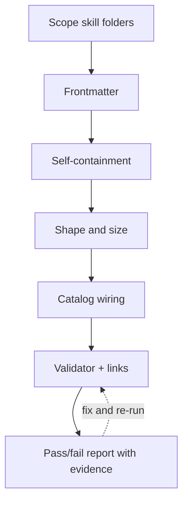

# skill-verify

The repository's skill gate. It checks a skill folder against the catalog rules
and reports pass/fail with evidence. Canonical instructions:
[`SKILL.md`](../../.agents/skills/skill-verify/SKILL.md); human page:
[`docs/skills/skill-verify.md`](../../docs/skills/skill-verify.md).

## Invariants

1. It runs before any skill creation or change is reported as done; a manual
   read of the checklist is a fallback, not a substitute.
2. Read-only unless the user asked for fixes; a fix belongs to the change under
   review, and affected checks are re-run after it.
3. Every result cites evidence — path and line, or command output — and an
   unavailable check is `unverified`, never `pass`.
4. The body is self-contained. It may name repository paths as things it checks,
   but never links to them as resources.
5. A skill passes only when every required check passes; the report lists what
   remains otherwise.

## Checks

## Why a skill, not only a checklist

A checklist in `AGENTS.md` states the rule; the skill executes it: resolves the
repo root, derives scope from git, runs the validator, resolves links, measures
the body, and returns evidence. The checklist stays as the documented fallback
when file or shell access is missing.

## Limits

- Token count is estimated as characters / 4, not tokenizer output; the report
  says so.
- The validator is `.venv/skills-ref` or `skills-ref` on `PATH`; without either,
  frontmatter validation is manual and marked unverified.
- It knows this repository's layout by design, which is the documented exception
  to the self-containment rule.

Related: [skills summary](summary.md),
[agent instructions](../../AGENTS.md),
[skill design rules](../../AGENTS.md#skill-design-rules).
