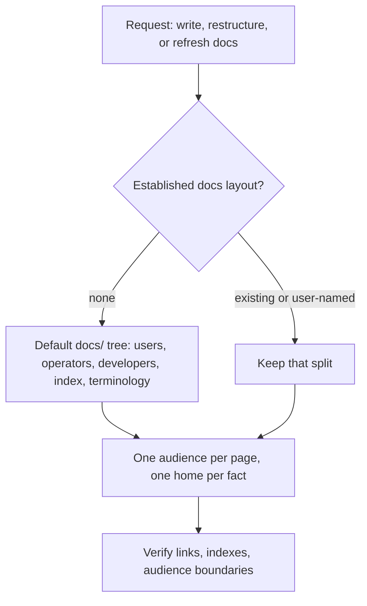

# software-documentation

The catalog's general documentation-authoring skill: it writes, restructures,
or refreshes documentation for any software project the user points it at, and
is the first member here with no X, browser, or runtime-state surface.
Canonical instructions:
[`SKILL.md`](../../.agents/skills/software-documentation/SKILL.md); human page:
[`docs/users/software-documentation.md`](../../docs/users/software-documentation.md).
Imported from the `joinup.now3` repository's skill tree; that copy can drift
from this one, and this catalog's copy is the one this repository documents.

## Rules the skill carries

- **Placement** — default `docs/` with `users/`, `operators/`, `developers/`
  subfolders, a `docs/README.md` index of one row per document, and
  `docs/terminology.md` beside them. An existing layout or a user-specified
  shape overrides the default; the skill keeps that split.
- **One audience per page** — user, operator, developer, or decision-maker; a
  second audience gets a link, never a restatement. `README.md` is a
  visitor-level introduction only. Index pages are scannable tables.
- **Configuration split** — operator pages own the deployment reference (every
  key, effect, precedence, default, secret handling); developer pages own the
  configuration system's mechanics; each rewritten per audience, linked across.
- **One home per fact** — stated completely once on the owning page; everything
  else links. Terms defined once in the terminology guide, positively (what a
  term is, never what it is not); acronyms and opaque jargon expanded at first
  use.
- **External references** — link plus named source in the prose, never a bare
  link or unnamed paraphrase; official vendor sources first.
- **Current state only** — no changelogs, decision history, run-specific
  counts, or stale completion claims. Code and executable tests win over
  documentation; the docs are reconciled in the change that found the drift.
  Plans carry an explicit status (governing / executed / archived); session
  scratch goes to ignored directories.
- **Write with the change** — behavior, structural, and diagram drift update in
  the same change; a mechanical knowledge checker runs where the repository
  ships one.
- **Diagrams** — Mermaid embedded beside the owning page, portrait, rewritten
  per audience like any fact, deleted when they only restate the prose.
- **Markdown style** — plain and portable, one block per source line, relative
  sibling links without heading fragments, no wikilinks or vendor extensions.
- **Code-level docs** — doc comments on meaningful public contracts only.
- **Verification** — link and consistency checks instead of the build: paths
  resolve, index entries match disk, audience boundaries hold.

## Identity

- Not a group member: no browser, no group-shared file, no `compatibility`
  requirements beyond file access, no runtime state.
- Self-contained: the body names no file outside its folder. Its `docs/`
  strings are the target project's default layout, never links into this
  repository — the usual self-containment grep hits them, and the judgement is
  link-or-dependency, which these are not.

## Catalog wiring

README bullet under "The skills"; catalog row in `docs/skills/README.md`; row
in `docs/README.md` users table and `docs/users/README.md`; page at
`docs/users/software-documentation.md`; the terminology entry
"Software-documentation rules"; this file and its `lode-map.md` row.

Related: [skills summary](summary.md), [skill-verify](skill-verify.md),
[group rules](groups.md).
