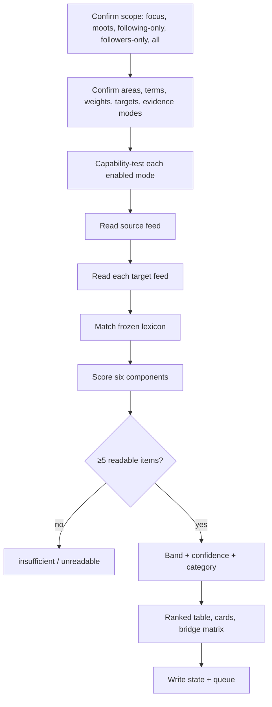

# twitter-compatibility

The catalog's scoring and comparison skill for accounts on X. It asks for the
scope — focus, moots, following-only, followers-only, or all — then which subjects
and factors matter, reads the signed-in user's feed and each target's feed, and
returns a 0–100 compatibility score with counted evidence. A named focus account is
scored whatever its relationship. Instructions live in the skill's own
`SKILL.md` (this checkout:
[`twitter-compatibility/SKILL.md`](../../.agents/skills/twitter-compatibility/SKILL.md));
human page:
[`docs/users/twitter-compatibility.md`](../../docs/users/twitter-compatibility.md).
Group files: [`twitter-core`](../../docs/skills/twitter-core.md) (contract),
[`twitter-shared`](../../docs/skills/twitter-shared.md) (operative rules copied to
`references/twitter-shared.md`).

## Invariants

1. Read-only. It never likes, replies, reposts, follows, block, reports, or
   messages; the entry point is a suggestion for the user, not an action.
2. Scope is asked first: `focus`, `moots`, `following-only`, `followers-only`, or
   `all` associated accounts. It is a population filter, not a rubric change; a
   category is confirmed from Following/Followers membership and the live `Follows
   you` marker, never inferred from the score. A named account is a focus target
   whatever its relationship; in neither list it is labelled `not-associated`, and
   that label never blocks or delays scoring.
3. Both sides are read fresh every run. The source feed is the signed-in user's own
   Posts, Replies, Media, and visible Likes; the target's is the scored account's
   posts, replies, reposts, and media. State is memory, never evidence.
4. Areas, signal terms, area weights, factor weights, evidence modes, targets, and
   budget come from the user and are restated before scoring. The lexicon is the
   measuring instrument.
5. A score is arithmetic over counted items. Every component has point values and a
   formula in
   [`references/scoring.md`](../../.agents/skills/twitter-compatibility/references/scoring.md);
   every reported score shows its counts.
6. A repost is secondhand, not authorship, and is weighted lower. Text is the
   default: an image, frame, or transcript is 0 subject evidence unless that mode is
   opted in and proven. Then an image or video frame counts 1 point (2 in a `visual`
   area), an audio transcript 1, caps at 6 or 12 per area, and non-text-only matches
   cap confidence at `medium`.
7. Confidence is separate from score: `high`, `medium`, `low`, `insufficient`,
   `unreadable`. Fewer than five readable target items is `insufficient`, not a
   zero; a protected or notice-replaced page is `unreadable`, with no score and no
   inference.
8. Relationship is a bonus, capped at the default 5% access component. `Follows
   you` never carries a ranking.
9. A score is current for 14 days. Any change to an area, term, weight, mode,
   window, evidence mode, or a `visual` area flag bumps the rubric version and makes
   every earlier score stale and unrankable until re-read. A scope change does not;
   it changes who is reported.
10. State lives outside the repository at `~/.x-compatibility/<handle>.json`, one
    file per signed-in account, and holds the scope, focus handles, evidence modes,
    area flags, rubric data, aggregates, scores, categories, counts, queue, hidden
    handles, and dates — no quotes, permalinks, images, or private details.
11. A report is not a prediction. A high score means more shared, replyable
    material in the sample, not friendship, agreement, or a reply.
12. Every enabled evidence mode is capability-tested once per run. A failed test is
    reported `unavailable`, text continues, and the absent evidence is never scored
    as a silent zero or guessed from a caption, filename, or poster.

## Pipeline

## Why the score is objective

"Objective" here means reproducible arithmetic on a stated sample, not a claim of
scientific measurement. Four things make it checkable:

- The signal lexicon is confirmed before reading and frozen in the rubric, so the
  same post matches the same area on every run.
- Every component is a count with a cap and a formula; the report prints the
  counts.
- The sample is bounded and named: tab caps, a 30-day default window, and a
  confidence level derived from what was actually read.
- Visual and multimodal evidence is opt-in, capability-tested per mode, lower-weight,
  and capped; text remains the default and the only reliable path across hosts, and
  an unproven mode is reported, never silently zeroed.

The limits are stated in the same breath: public posts are not intent, a thread can
lift one area, reposts are not voice, and the voice component compares style ratios
rather than personality.

## Score shape

| Component | Default weight | Counts |
| --- | --- | --- |
| Subject | 40 | Matched posts, replies, quotes, reposts, captioned media per weighted area |
| Conversation | 25 | Replies to others and to the source, questions, invitations, commentary quotes, threads, polls |
| Format | 15 | Distance between the formats the source engages with and the target's formats |
| Voice | 10 | Median length, question rate, first-person rate, emoji rate |
| Recency | 5 | Newest original post and posts per week |
| Access | 5 | Follows you, replied to you, public profile |

`reply-first`, `quote-first`, and `observe-only` presets change the defaults; the
user may set any weights, and the final normalized set is reported. Area scores are
separate and combined by 1–5 area weights, so the ranking follows the subjects the
user actually cares about. Scope selects the population and is shown as a category;
it does not change the weights. Evidence modes are a separate rubric setting:
image, frame, and transcript evidence is 0 by default, and lower-weight only when
the user opts in and the session proves that mode; text is the cheap default.

Bands: Strong 85–100, Good 70–84, Workable 55–69, Thin 40–54, Low 0–39. Only
`high` and `medium` confidence scores are ranked; `low` sits in a provisional block.

## Display

One ranked table with a ten-cell bar, category, band, strongest area, main gap, and
confidence; a card per account with category, per-area rows, component scores, two
or three quoted items with dates and permalinks, non-text count when on, fit, gap,
caution, and at most one entry point; a bridge matrix of areas by the top accounts;
and separate lower-scored, provisional, insufficient, unreadable, out-of-scope, and
hidden lists. `not-associated` is a category for a named focus account, shown as
context rather than a caution. The template is
[`references/report-format.md`](../../.agents/skills/twitter-compatibility/references/report-format.md).

An entry point is the newest matching post within 14 days that asks a question or
invites a reply. It names an angle grounded in the quoted post; it never drafts a
message to send or performs an interaction.

## State and cost

Schema and staleness rules:
[`references/state-file.md`](../../.agents/skills/twitter-compatibility/references/state-file.md).
Default batch is three targets per run, six maximum, plus the source; source and
target tabs are capped at 40/30 posts, 30/20 replies, 15/10 media, and 15 likes.
Profile visits are the expensive unit, so state lets later runs read only new or
stale targets instead of re-reading the whole set. Changing the rubric invalidates
scores but not handles, categories, or the queue; changing only the scope keeps
every score and changes who is reported. A focus run stores its named handles and
scores them like any target. Evidence modes and `visual` area flags live
in the rubric; capability is per run because the host may change.

When file write is refused or unavailable, the run continues on session state of
the same shape and prints it for the user to verify; the next run starts fresh and
may repeat work, which is accepted.

## Self-contained

The skill never links to `docs/` or this lode. A copied folder carries its body, the
shared rules, the scoring formulas, the report template, and the state schema.
Duplication is deliberate; the central files are the authoring sources every copy
is checked against.

Related: [skills summary](summary.md), [twitter-followback](twitter-followback.md),
[twitter-moot-radar](twitter-moot-radar.md), [twitter group](twitter-group.md),
[terminology](../terminology.md).
