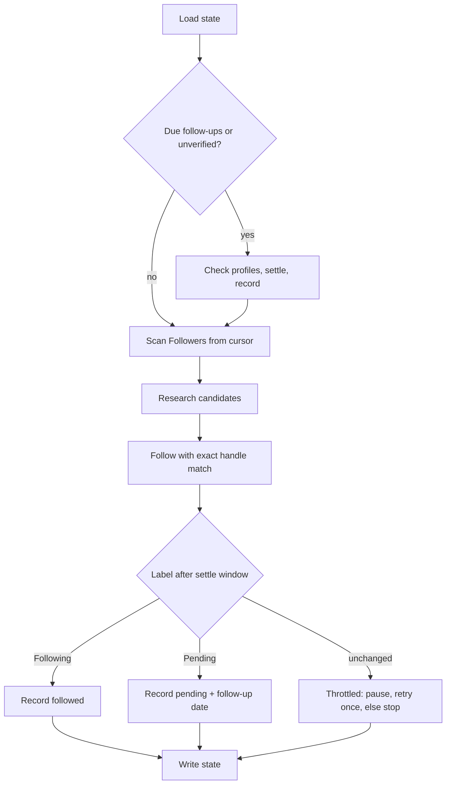

# twitter-followback

The catalog's browser-driven skill. It follows back real people on X and keeps
its own run state between sessions. Canonical instructions:
[`SKILL.md`](../../.agents/skills/twitter-followback/SKILL.md); human page:
[`docs/skills/twitter-followback.md`](../../docs/skills/twitter-followback.md).

## Invariants

1. Research before every follow; nothing is followed because it appeared in a
   list.
2. Verify after a settle window of up to 30 seconds, never inside it. A second
   click can unfollow or cancel a request.
3. A protected account ends at `Pending`, never `Following`.
4. The live UI wins over saved state; a saved `followed` is not proof.
5. State lives outside the repository, one file per signed-in account.
6. Never unfollow, block, report, or message.

## Run loop



## State file

```text
~/.x-followback/<handle>.json
%USERPROFILE%\.x-followback\<handle>.json   (Windows)
```

```json
{
  "account": "@me",
  "criteria": "recency<=30d; skip marketing/adult/crypto; protected=skip",
  "scannedThrough": "@handle",
  "queue": ["@erin"],
  "processed": {"@alice": {"state": "followed", "on": "2026-11-21"}},
  "followUps": [{"handle": "@carol", "checkOn": "2026-11-28"}]
}
```

States: `followed`, `already_following`, `skipped`, `pending`, `unverified`,
`blocked`. `pending` is an outstanding follow request; `unverified` is a click
whose state change was never observed. Every pending or unverified entry also
gets a `followUps` entry. `queue` holds collected handles that have no verdict;
the cursor alone would drop them.

## Why a state file

- The Followers list is virtualised and can hold hundreds of rows; it keeps
  paging, so one run cannot exhaust it.
- X throttles after a short burst and the UI updates late, so runs end mid-queue.
- Follow requests resolve over days, if at all.

Without it, every run re-researches the same handles and may re-follow accounts
whose button simply had not updated.

## Why it is not in the repo

The state file is runtime data of the user's machine, not part of the skill.
Keeping it outside preserves the droppable-repository rule in
[AGENTS.md](../../AGENTS.md): no build step, no generated artifacts, no secrets.

Related: [skills summary](summary.md), [practices](../practices.md),
[terminology](../terminology.md).
