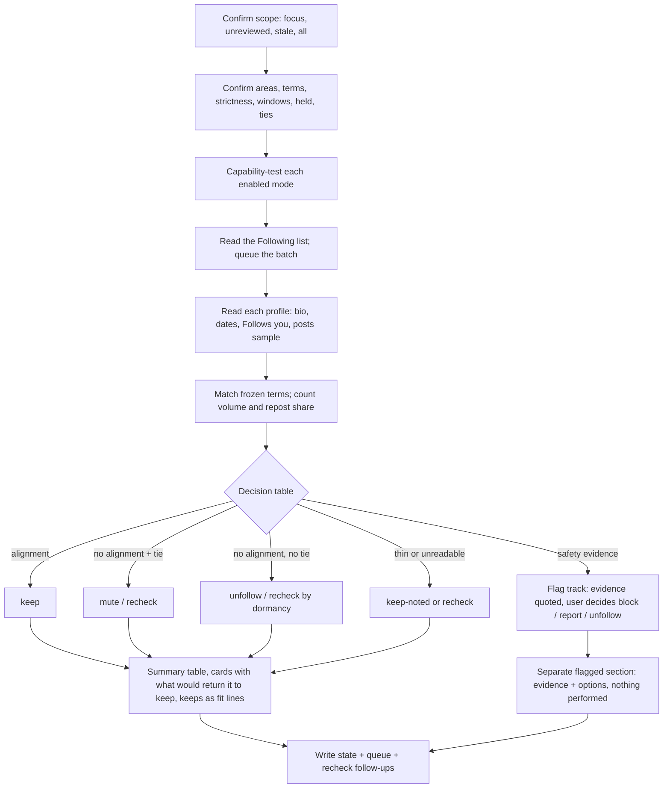

# twitter-following-audit

The catalog's Following-list audit skill. It asks for a scope — focus,
unreviewed, stale, or all — then the user's interests and windows, reads each
followed account's bio, newest post date, and recent posts, and suggests one
verdict per account: `keep`, `unfollow`, `mute`, or `recheck`. A verdict is a
suggestion the user applies; the run performs no action on X. Safety findings
are a separate flag track, never verdicts.
Instructions live in the skill's own `SKILL.md` (this checkout:
[`twitter-following-audit/SKILL.md`](../../.agents/skills/twitter-following-audit/SKILL.md));
human page:
[`docs/users/twitter-following-audit.md`](../../docs/users/twitter-following-audit.md).
Group files: [`twitter-core`](../../docs/skills/twitter-core.md) (contract),
[`twitter-shared`](../../docs/skills/twitter-shared.md) (operative rules copied
to `references/twitter-shared.md`).

## Invariants

1. Read-only, and suggestion-only: it never unfollows, blocks, mutes, follows,
   likes, reposts, reports, or messages. Every verdict names an action for the
   user to take.
2. Optimism is a rule, not a tone. `keep` needs no evidence; every other
   verdict needs a quoted, dated item or a counted dormancy fact; thin,
   insufficient, or unreadable evidence never lands a negative verdict; the
   audit never suggests block at all.
3. The skill never infers disagreement from content. `disagreement` is a
   reason tag only when the user names it. A verdict describes fit between the
   account now and the interests named now — never worth, character,
   politics, or personality.
4. Scope is asked first: `focus` (named accounts), `unreviewed` (no verdict
   yet), `stale` (older than 90 days or another audit version), or `all`
   (everything, queued over runs). A named handle is a focus target whatever
   its relationship; not being followed is context, not a gate.
5. The decision table is the single arbiter: alignment in the window means
   `keep`; no alignment plus a tie (moot, follows the user, replied to the
   user, or user-named) means `mute` or `recheck`; no alignment and no tie
   means `unfollow` or `recheck` with dormancy deciding. Where the table
   offers the user's call, the optimistic verdict leads and is recorded until
   the user picks.
6. Safety findings are a separate flag track, not verdicts: quoted, dated,
   profile-level evidence of bot or follow-farm patterns, scams, harassment
   toward the user, or impersonation routes the account out of the verdict
   set whatever its alignment. A flag never carries a verdict and a verdict
   never carries a flag. The flag card names the user's options — block
   (severs contact and also unfollows; warranted for harassment or
   impersonation, reasonable for interacting scams and bots), report where
   platform rules are implicated, or unfollow alone (the minimum for a
   harmful account that never interacts) — decided by the user, never
   performed.
7. Reason tags are neutral and dated: `inactive`, `focus-moved`,
   `outside-interests`, `volume`, `repost-heavy`, `disagreement`. Flags carry
   their own reason (bot/farm, scam, harassment, impersonation). A keep
   carries a fit line, not a reason tag.
8. Every non-keep card leads with what the account gives or gave, names what
   would return it to keep, and names the alternative verdict. Unfollow is
   "not now": private, reversible, unannounced by X.
9. Text is the default evidence mode; image, video-frame, and transcript
   evidence is opt-in, capability-tested per run, lower-weight, capped (1
   profile image pair and 3 media items per account, 12 per run), and never
   proof of identity or a sensitive trait.
10. Windows are part of the audit version: active 90 days (newest post that
    still reads active), dormant 12 months (silence that reads long-dormant),
    recheck gap 90 days. Any change to an area, term, strictness, window, or
    evidence mode bumps the audit version and marks every verdict stale; a
    scope or batch change does not.
11. State lives outside the repository at `~/.x-following-audit/<handle>.json`,
    one file per signed-in account, and holds scope, focus handles, audit
    version, areas and terms, windows, held handles, named ties, per-account
    verdicts and flags with counts, queue, cursor, and follow-ups — no quotes,
    permalinks, images, or private details. Held handles never receive a
    verdict; an override records the user's final verdict and word.
12. Step 3 asks in the user's language per the shared asking rules: every
    question models the plain wording, states why it is asked and what the
    answer changes, and treats `focus`, `held`, and the verdict labels as
    recorded values, never the question's text. Areas and signal terms are
    proposed from what this run observed about the user — bio, pinned post,
    saved state, their words — as a guess to confirm, never a fixed subject
    such as a canned "Rust" example; with nothing observed, the question
    names the kind of answer wanted.

## Pipeline

## Why optimism is a rule

An unfollow suggestion from a scoring mindset drifts toward negativity: quiet
accounts read as failures, drifted accounts as betrayals. The audit inverts
the burden. Keep is free; a negative verdict must prove fit has ended with a
dated fact; a tie moves the verdict toward the connection-preserving options;
and every card states the way back. The user said the point is deciding
whether to stay connected for many reasons — activity, changed focus, drifted
interests — not judging people, so the language describes change, never
quality, and safety findings are flagged for the user instead of converted
into a block suggestion — block severs contact, which is a safety decision,
not a curation choice.

## Decision inputs

| Input | Source |
| --- | --- |
| Alignment | Matched item in the window against the frozen terms; a repost alone never aligns |
| Tie | `Follows you` on a followed profile, a reply to the user seen in the sample, or a named tie the user recorded |
| Activity | Newest post date against the active and dormant windows |
| Feed fit | Repost share and volume counts from the sample |
| Safety evidence | Quoted, dated, profile-level: bot/farm, scam, harassment, impersonation — routes to the flag track, never a verdict |

Confidence comes from the sample size: `high` at 8+ readable items, `medium`
at 3–7, `low` below 3; non-text-only matches cap at `medium`. It sits beside a
verdict and never flips one.

## State and cost

Schema and staleness rules:
[`references/state-file.md`](../../.agents/skills/twitter-following-audit/references/state-file.md).
Default batch is 20 accounts per run, 40 maximum, 45-minute wall clock; profile
visits are the expensive unit, so the queue and cursor let later runs pick up
mid-list. Verdicts are current for 90 days within one audit version.
`focus-moved` is computable only from state — a prior `keep` with a matched
item and none today — which is why verdicts persist.

When file write is refused or unavailable, the run continues on session state
of the same shape and prints it for the user to verify; the next run starts
fresh and may repeat work, which is accepted.

## Self-contained

The skill never links to `docs/` or this lode. A copied folder carries its
body, the shared rules, the verdict rules, the report template, and the state
schema. Duplication is deliberate; the central files are the authoring sources
every copy is checked against.

Related: [skills summary](summary.md), [twitter-compatibility](twitter-compatibility.md),
[twitter-moot-radar](twitter-moot-radar.md), [twitter-followback](twitter-followback.md),
[twitter group](twitter-group.md), [terminology](../terminology.md).
