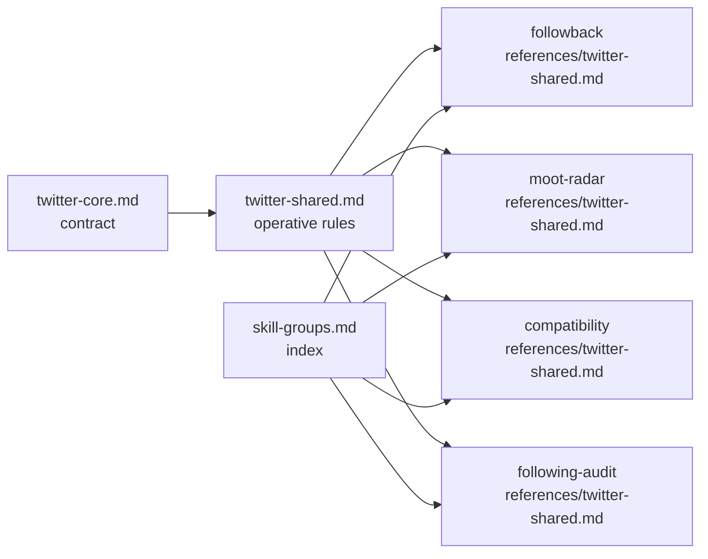

# twitter group

The first skill group. It holds the rules shared by every X/Twitter skill and
applies the group mechanics in [groups](groups.md).

## Members

| Skill | Task |
| --- | --- |
| [`twitter-followback`](../../.agents/skills/twitter-followback/SKILL.md) | Follow back real, active followers, with optional non-text checks |
| [`twitter-moot-radar`](../../.agents/skills/twitter-moot-radar/SKILL.md) | Suggest matching accounts from the moot graph, or assess one named account, with optional non-text proof |
| [`twitter-compatibility`](../../.agents/skills/twitter-compatibility/SKILL.md) | Score interaction compatibility across associated-account scopes or one named account, text-first with opt-in multimodal evidence |
| [`twitter-following-audit`](../../.agents/skills/twitter-following-audit/SKILL.md) | Audit the Following list and suggest keep, unfollow, mute, or recheck per account, flagging safety findings separately for the user to act on, optimistic and read-only, with opt-in multimodal evidence |

## Central files

| File | Role | Copy |
| --- | --- | --- |
| [`twitter-core.md`](../../docs/skills/twitter-core.md) | Contract: principles, practices, considerations | None; authoring page |
| [`twitter-shared.md`](../../docs/skills/twitter-shared.md) | Operative rules: state line, linked evidence, cadence, access failures, persistence fallback, multimodal evidence, privacy | `references/twitter-shared.md` in every member |
| [`skill-groups.md`](../../docs/skills/skill-groups.md) | Group index and naming convention | None |

## Invariants

1. A central file carries the group in its name; a file that names one group is
   never copied into another.
2. `twitter-shared.md` is copied verbatim into every member. A body names its
   copy and says when to read it; a member never links outside its own folder.
3. The central file and every copy change together. A mismatch is a defect, not a
   work in progress.
4. The contract explains and decides; the shared file carries the operative text.
   A rule with no rationale may live only in the shared file; a rule with a
   decision worth explaining also appears in the contract.
5. `skill-verify` checks that a member's copy is byte-identical to the central
   file and that the index lists the member.
6. A cross-group capability page is named for the capability, not a group, such
   as [`browser-cadence.md`](../../docs/skills/browser-cadence.md).
7. Text is every member's default evidence mode. An enabled multimodal mode is
   capability-tested once per run and reported `available` or `unavailable`; the
   shared file is the one place that rule is authored and it is copied verbatim.
8. The assessment members — `twitter-moot-radar`, `twitter-compatibility`, and
   `twitter-following-audit` — accept a named focus account. A relationship label —
   `moot`, `following-only`, `followers-only`, or `not-associated` — is context,
   never a gate; this is authored per member because `twitter-followback` acts on
   a follower queue rather than assessing a named account.
9. Every member is written for a real person on their own personal X account —
   never engagement farming, marketing, or brand work. Each description, body
   intro, and Safety section states it, and the contract records the decision.
   Words that carry the negative marketing or engagement flavor never describe
   the skills' own behavior: lists are read, collected, and scanned (never
   "harvested"), a repost is "secondhand" (never "amplification"), the bio
   signal is "selling" (never "promotion"). Exclusion labels and disclaimers
   keep their standard names (marketing/funnel, engagement bait, follow farm,
   growth hacking), because their context pins them to what is skipped or
   rejected, not to what the skill does.
10. Every question a run asks the user stands alone: one decision, plain
    words, the reason for asking, what each answer changes, an example where
    it helps, and a default or "none" path; terms of art are translated
    inline, never bare. Examples come from the user's own world — the
    signed-in profile, anything already read this run, saved state, their
    words — offered as a guess to confirm, never a fixed script. The rule is
    authored once in `twitter-shared.md` and copied verbatim; each member's
    brief step states it where the questions are formed. The contract records
    the decision as principle 20.

## Why copies, not links

A skill folder is installed on its own. A link to `docs/` or another skill would
break the moment the folder is copied, so the operative rules are copied into
each member. The central file is the edit point; the copies are what the agent
reads at runtime.

Related: [skills summary](summary.md), [group rules](groups.md),
[twitter-followback](twitter-followback.md),
[twitter-moot-radar](twitter-moot-radar.md),
[twitter-compatibility](twitter-compatibility.md),
[twitter-following-audit](twitter-following-audit.md),
[shared rules](../../docs/skills/twitter-shared.md).
