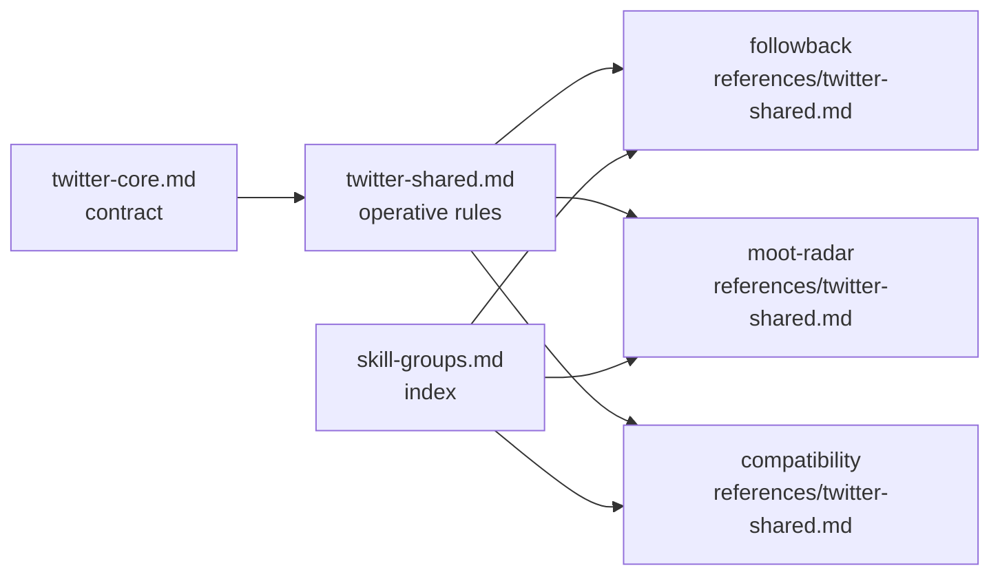

# twitter group

The first skill group. It holds the rules shared by every X/Twitter skill and
applies the group mechanics in [groups](groups.md).

## Members

| Skill | Task |
| --- | --- |
| [`twitter-followback`](../../.agents/skills/twitter-followback/SKILL.md) | Follow back real, active followers, with optional non-text checks |
| [`twitter-moot-radar`](../../.agents/skills/twitter-moot-radar/SKILL.md) | Suggest matching accounts from the moot graph, with optional non-text proof |
| [`twitter-compatibility`](../../.agents/skills/twitter-compatibility/SKILL.md) | Score interaction compatibility across associated-account scopes, text-first with opt-in multimodal evidence |

## Central files

| File | Role | Copy |
| --- | --- | --- |
| [`twitter-core.md`](../../docs/skills/twitter-core.md) | Contract: principles, practices, considerations | None; authoring page |
| [`twitter-shared.md`](../../docs/skills/twitter-shared.md) | Operative rules: state line, linked evidence, cadence, access failures, persistence fallback, multimodal evidence, privacy | `references/twitter-shared.md` in every member |
| [`skill-groups.md`](../../docs/skills/skill-groups.md) | Group index and naming convention | None |

## Invariants

1. A central file carries the group in its name; a file that names one group is
   never copied into another.
2. `twitter-shared.md` is copied verbatim into every member. A body names its
   copy and says when to read it; a member never links outside its own folder.
3. The central file and every copy change together. A mismatch is a defect, not a
   work in progress.
4. The contract explains and decides; the shared file carries the operative text.
   A rule with no rationale may live only in the shared file; a rule with a
   decision worth explaining also appears in the contract.
5. `skill-verify` checks that a member's copy is byte-identical to the central
   file and that the index lists the member.
6. A cross-group capability page is named for the capability, not a group, such
   as [`browser-cadence.md`](../../docs/skills/browser-cadence.md).
7. Text is every member's default evidence mode. An enabled multimodal mode is
   capability-tested once per run and reported `available` or `unavailable`; the
   shared file is the one place that rule is authored and it is copied verbatim.

## Why copies, not links

A skill folder is installed on its own. A link to `docs/` or another skill would
break the moment the folder is copied, so the operative rules are copied into
each member. The central file is the edit point; the copies are what the agent
reads at runtime.

Related: [skills summary](summary.md), [group rules](groups.md),
[twitter-followback](twitter-followback.md),
[twitter-moot-radar](twitter-moot-radar.md),
[twitter-compatibility](twitter-compatibility.md),
[shared rules](../../docs/skills/twitter-shared.md).
