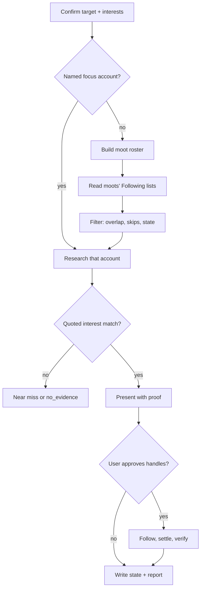
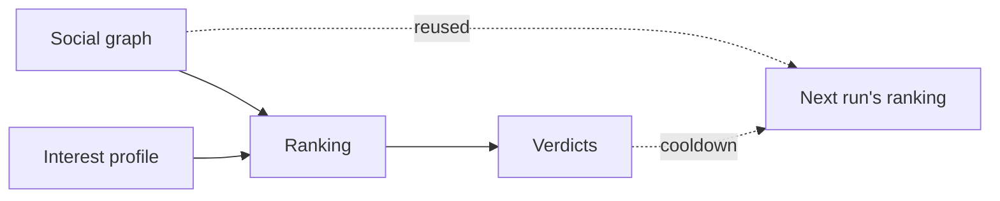

# twitter-moot-radar

The catalog's recommendation and account-assessment skill. It asks the user for
interests, reads what their mutuals follow, and returns matching accounts with
quoted proof; or it assesses one account the user names, whatever its relationship.
Instructions live in the skill's own `SKILL.md` (this checkout:
[`twitter-moot-radar/SKILL.md`](../../.agents/skills/twitter-moot-radar/SKILL.md));
human page:
[`docs/users/twitter-moot-radar.md`](../../docs/users/twitter-moot-radar.md).
Group files: [`twitter-core`](../../docs/skills/twitter-core.md) (contract),
[`twitter-shared`](../../docs/skills/twitter-shared.md) (operative rules copied to
`references/twitter-shared.md`).

## Invariants

1. Interests come from the user and are restated as checkable areas before any
   reading or assessment.
2. Only mutuals' Following lists are read — never suggestion modules,
   Explore, search, or a moot's Followers tab. A `Promoted` row injected into
   a Following list is an ad, not the moot's follow.
3. A moot is confirmed by the `Follows you` marker before their list is used;
   appearing in the Following list alone is not enough.
4. Overlap is counted per distinct moot, and the default bar is two on a graph
   run. A focus account needs no overlap; `0` is reported as context, never as a
   shortfall.
5. No suggestion without a quoted post or bio line, with its date and permalink.
6. A protected account has unreadable posts, and a "potentially sensitive
   content" interstitial can replace a profile outright; either way no suggestion
   is possible, and the account is reported unreadable, not guessed at.
7. "Not followed" is proven by the live `Follow @handle` control, never by absence
   from a list.
8. Nothing is followed without per-handle approval; approved handles get
   exact-handle matching and the settle-window check, which runs to about two
   minutes. `Following` and `Unfollow` both prove a follow.
9. Moots and sources are interest-independent and reused across interest changes;
   verdicts are re-derived from the new profile, without re-reading the graph.
10. Cadence, throttling, credential handoff, and reporting honesty are copied
    into `references/twitter-shared.md` from the group's central file; a copied
    skill has no access to `docs/`.
11. A run opens with one short state line: the file path, interests in force, moot
    and source counts, queue and verdict counts, and last write. No file means the
    run starts fresh.
12. Reports link what they name: every handle a run lists — state line, question,
    or report — to `https://x.com/<handle>`, and each quote to its post
    permalink, from pages read this run. No invented URLs.
13. A page that did not load is an access failure, not a verdict. Stop, flag what
    failed and the resume point, and write nothing for an item whose page never
    loaded; a click already made is `unverified` with a follow-up. Never infer
    no_evidence, an empty list, or not followed.
14. Text is the default evidence mode. Opted-in image, video, or transcript proof
    is labelled, ranks below a quoted post, and caps that suggestion at medium
    confidence; profile images may flag spam or impersonation but never prove a real
    person or a sensitive trait, and a failed mode is `unavailable`, never a zero.
15. A named account is a focus target: no roster or list reads, skip patterns
    become cautions, and its follow-back state and moot overlap are context. The
    interest-evidence gate still applies, and the report does not push the user
    toward a different account because it is not a moot.
16. Setup guidance follows the shared principles: when browser control is
    missing the run asks one question on depth (step by step for a new user,
    short version, or self-setup), names the environment, guides only from
    official vendor documentation read that run, offers first-party options
    first, takes the user's yes for every change to the machine, hands login
    to the user, and continues only on a passed control proof. Vendor
    commands, URLs, and product names are never hard-coded.

## Pipeline



## State file

```text
~/.x-moot-radar/<handle>.json
%USERPROFILE%\.x-moot-radar\<handle>.json   (Windows)
```

The schema, verdict vocabulary, and writing rules are the skill's
[`references/state-file.md`](../../.agents/skills/twitter-moot-radar/references/state-file.md);
that file is authoritative and the body names it.

States: `suggested`, `dismissed`, `followed`, `pending`, `unverified`,
`already_following`, `skipped`, `no_evidence`, `unreadable`. A focus account's
verdict carries `focus: true` and needs no graph entry.

When the write is refused or unavailable, the run continues on session state of
the same shape and prints it for the user to verify; the graph, cooldowns, and
verdicts are then lost between runs, and that repeated work is accepted.

## Why sources and verdicts are separate

The social graph (`moots`, `sources`) is expensive to read and independent of the
question being asked. The verdicts depend on the interest profile. Keeping them
in separate maps means a new interest list re-ranks an existing graph instead of
re-crawling hundreds of Following rows, while old verdicts never silently apply
to a new rubric.



## Cost model

Row reads are cheap; profile visits are the throttled, expensive unit, and an
opted-in visual read costs several text items. The skill therefore filters at the
row level — overlap bar, bot/brand patterns, previous verdicts — and shortlists about
three times the suggestion budget so that research losses do not empty the report.

## Overlap is relevance, not interest

Two moots following an account is a meaningful coincidence of taste. It is not
evidence that the account posts about the interest; only the account's own words
are. The report shows both, and the interest quote is the gate. A focus account may
have zero overlap: the quote still decides the verdict, and the zero is stated as
context.

## Self-contained

The skill never links to `docs/` or this lode. A folder can be copied out on its
own, so its `SKILL.md` and `references/twitter-shared.md` carry the cadence table,
skip patterns, settle window, and state shape rather than pointing at the group's
central files. Duplication is deliberate; the central files are the authoring
sources that every copy is checked against.

Related: [skills summary](summary.md), [twitter-followback](twitter-followback.md),
[twitter group](twitter-group.md), [terminology](../terminology.md).
