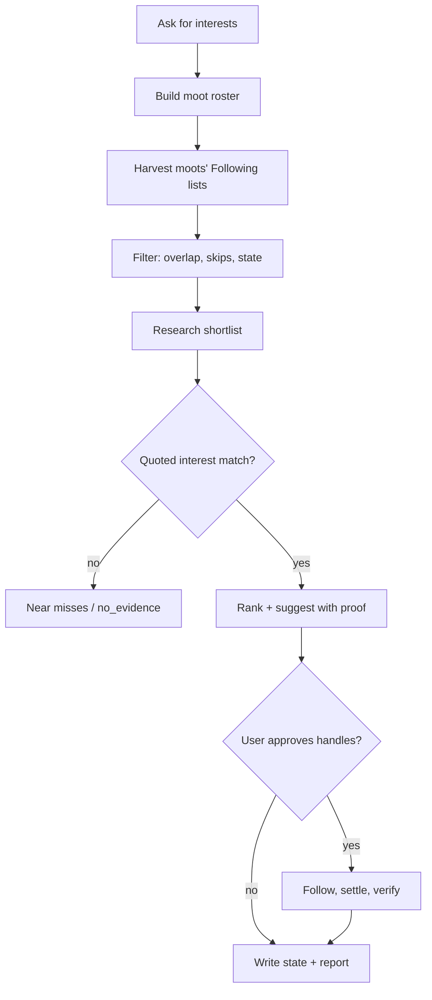
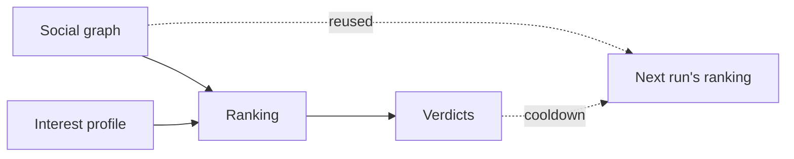

# twitter-moot-radar

The catalog's recommendation skill. It asks the user for interests, harvests what
their mutuals follow, and returns matching accounts with quoted proof.
Instructions live in the skill's own `SKILL.md` (this checkout:
[`twitter-moot-radar/SKILL.md`](../../.agents/skills/twitter-moot-radar/SKILL.md));
human page:
[`docs/skills/twitter-moot-radar.md`](../../docs/skills/twitter-moot-radar.md).
Family rules: [`twitter-core`](../../docs/skills/twitter-core.md).

## Invariants

1. Interests come from the user and are restated as checkable areas before any
   harvesting.
2. Only mutuals' Following lists are harvested — never suggestion modules,
   Explore, search, or a moot's Followers tab.
3. A moot is confirmed by the `Follows you` marker before their list is used;
   appearing in the Following list alone is not enough.
4. Overlap is counted per distinct moot, and the default bar is two.
5. No suggestion without a quoted post or bio line, with its date and permalink.
6. A protected account has unreadable posts, so no suggestion is possible; it is
   reported, not guessed at.
7. "Not followed" is proven by the live `Follow @handle` control, never by absence
   from a list.
8. Nothing is followed without per-handle approval; approved handles get
   exact-handle matching and the settle-window check.
9. Moots and sources are interest-independent and reused across interest changes;
   verdicts are re-derived from the new profile, not re-harvested.
10. Cadence, throttling, credential handoff, and reporting honesty are written
    into the skill body from the family contract; a copied skill has no access to
    `docs/`.

## Pipeline



## State file

```text
~/.x-moot-radar/<handle>.json
%USERPROFILE%\.x-moot-radar\<handle>.json   (Windows)
```

The schema, verdict vocabulary, and writing rules are the skill's
[`references/state-file.md`](../../.agents/skills/twitter-moot-radar/references/state-file.md);
that file is authoritative and the body names it.

States: `suggested`, `dismissed`, `followed`, `pending`, `unverified`,
`already_following`, `skipped`, `no_evidence`.

## Why sources and verdicts are separate

The social graph (`moots`, `sources`) is expensive to read and independent of the
question being asked. The verdicts depend on the interest profile. Keeping them
in separate maps means a new interest list re-ranks an existing graph instead of
re-crawling hundreds of Following rows, while old verdicts never silently apply
to a new rubric.



## Cost model

Row reads are cheap; profile visits are the throttled, expensive unit. The skill
therefore filters at the row level — overlap bar, bot/brand patterns, previous
verdicts — and shortlists about three times the suggestion budget so that
research losses do not empty the report.

## Overlap is relevance, not interest

Two moots following an account is a meaningful coincidence of taste. It is not
evidence that the account posts about the interest; only the account's own words
are. The report shows both, and the interest quote is the gate.

## Self-contained

The skill never links to `docs/` or this lode. A folder can be copied out on its
own, so its `SKILL.md` repeats the cadence table, skip patterns, settle window,
and state shape rather than pointing at the family contract. Duplication is
deliberate; the contract here is the authoring source that every copy is checked
against.

Related: [skills summary](summary.md), [twitter-followback](twitter-followback.md),
[family rules](../../docs/skills/twitter-core.md),
[terminology](../terminology.md).
